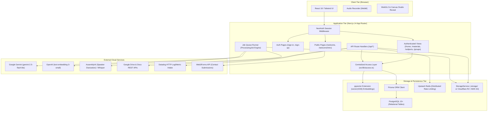
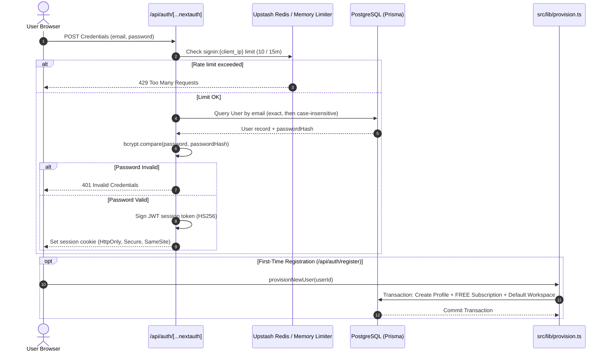
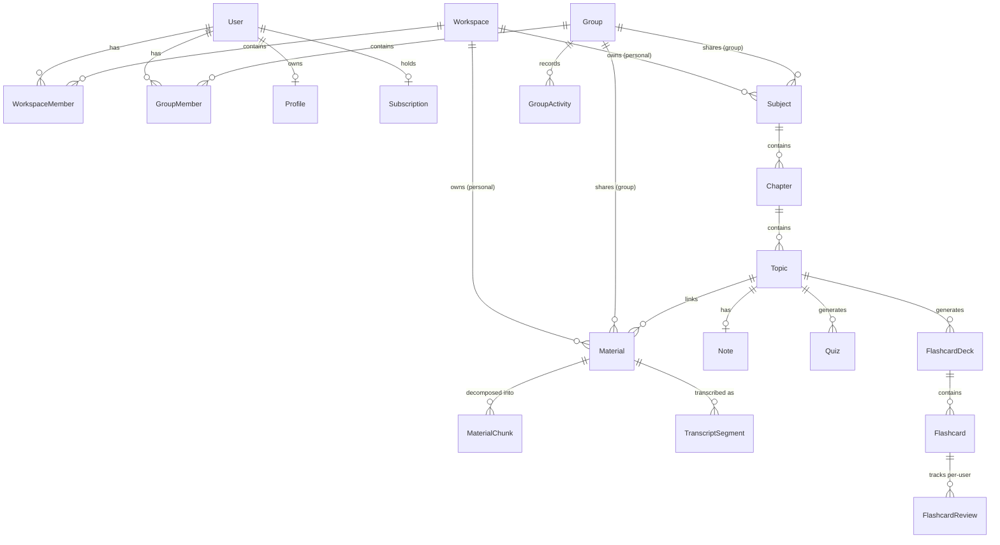
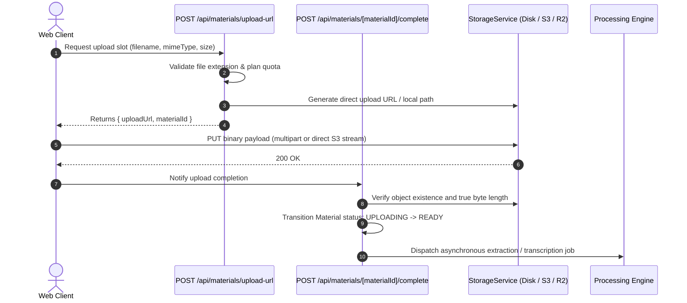
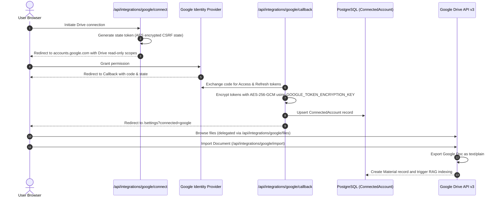
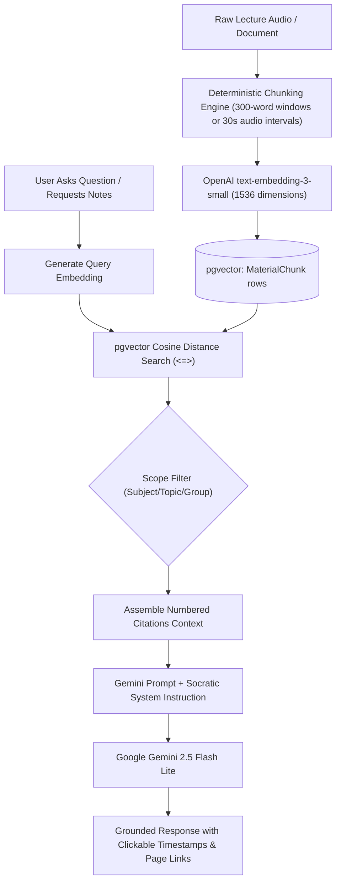

# Zenote Technical Architecture

This document provides a comprehensive technical reference for the Zenote system architecture, data models, service abstractions, background processing pipelines, and security boundaries.

---

## 1. High-Level System Architecture

Zenote is architected as an **AI-native monolithic application** utilizing the **Next.js 14 App Router**. It unifies presentational client components, server-side data loaders, authenticated API route handlers, and asynchronous job processing within a single deployable unit.



### Architectural Principles:
1. **Separation of Concerns Without Premature Distribution:** Route handlers act as the API layer, while domain services (`src/lib/services/`) isolate external SDKs. Background tasks (transcription, document text extraction, vector embedding) use a database-backed state machine (`ProcessingJob`) that can be factored out into a dedicated worker process if scale dictates.
2. **Interface-First Service Design:** Every third-party capability (AI, embeddings, speech-to-text, object storage) is guarded behind a TypeScript interface in `src/lib/services/interfaces.ts`. No route or component imports vendor SDKs directly.
3. **Defense-in-Depth Authorization:** Rather than relying exclusively on routing middleware, all resource queries and mutations call explicit, centralized access assertions in `src/lib/access.ts`.

---

## 2. Frontend & Application Routing

The frontend utilizes Next.js 14 App Router route groups to cleanly decouple layout boundaries, caching strategies, and authentication states:

| Route Group / Path | Purpose | Caching / Rendering Strategy |
|---|---|---|
| `src/app/(auth)/*` | `/sign-in`, `/sign-up` — Split-screen editorial authentication layout with floating ambient canvas and branding. | Static prerendering with client-side interactive forms. |
| `src/app/(app)/*` | `/home`, `/subjects/*`, `/materials/*`, `/flashcards/*`, `/quizzes/*`, `/assistant`, `/groups/*`, `/settings` — Main application shell. | Dynamic server-side rendering with streaming; requires active NextAuth session. |
| `src/app/welcome/*` | `/welcome` (brand splash & Studio reveal), `/welcome/intro` (8-section product narrative). | Static generation (`○`); dark-mode viewport and critical layout CSS. |
| `src/app/api/*` | REST endpoints for data mutations, file streaming, AI generation, Google integration, and health checks. | Dynamic route handlers (`force-dynamic`). |
| `src/app/manifest.ts` | `/manifest.webmanifest` | Static PWA manifest generator. |
| `src/app/robots.ts` | `/robots.txt` | Dynamic crawler directives with private route disallow list. |
| `src/app/sitemap.ts` | `/sitemap.xml` | Dynamic canonical XML sitemap generator. |

---

## 3. Authentication & Authorization Flow

Authentication is managed via **NextAuth.js v4** using a stateless **JWT session strategy**.



### Authorization Architecture (`src/lib/access.ts`):
- `requireUser()`: Asserts that an active session exists; redirects unauthenticated requests to `/sign-in` or throws `UnauthorizedError` in API contexts.
- `assertCanAccess(resourceType, resourceId, userId, requiredRole)`: Validates that the user is the owner, a valid workspace member, or a group member with sufficient privileges.
- `getSafeCallbackUrl(rawUrl)`: Validates redirection targets post-login, strictly rejecting protocol-relative URLs (`//evil.com`), backslash bypasses (`/\evil.com`), and infinite redirect loops.

---

## 4. Multi-Tenancy & Data Model Relationships

Zenote enforces multi-tenancy at the data layer through a dual-boundary model: **Personal Workspaces** and **Collaborative Groups**.



### Key Isolation Invariants:
1. **Dual Scoping:** Every `Subject` and `Material` belongs either to a personal `Workspace` (`workspaceId`) OR to a collaborative `Group` (`groupId`). No entity can float un-scoped.
2. **Private Activity Partitioning:** In a shared Group, `Materials` and `Subjects` are visible to all members. However, a user's `QuizAttempt` scores and `FlashcardReview` confidence ratings remain strictly private to the individual learner (`where: { userId }`).

---

## 5. Database & ORM Architecture (PostgreSQL + pgvector)

- **ORM:** Prisma 5.20 with PostgreSQL 15+.
- **Vector Column:** `MaterialChunk.embedding` is defined as a `vector(1536)` column managed via raw SQL migration:
  ```sql
  CREATE EXTENSION IF NOT EXISTS vector;
  ALTER TABLE "MaterialChunk" ADD COLUMN IF NOT EXISTS "embedding" vector(1536);
  CREATE INDEX IF NOT EXISTS "material_chunk_embedding_idx" ON "MaterialChunk" USING ivfflat ("embedding" vector_cosine_ops) WITH (lists = 100);
  ```
- **Prisma Integration:** Because Prisma does not have native schema primitives for vector arithmetic, raw parameterized SQL (`$queryRaw`) is used for all cosine distance operations, ensuring complete protection against SQL injection while taking advantage of IVFFlat index acceleration.
- **Query Optimization (`lib/material-list-select.ts`):** List views specifically project lightweight metadata fields, excluding large document text (`extractedText`) and slide JSON (`extractedPages`), reducing payload size by over 99% on dashboard views.

---

## 6. File Upload, Storage & Ingestion Workflow



### Supported Material Types:
- **Audio (`.mp3`, `.wav`, `.m4a`, `.webm`):** Duration probing, metadata extraction via `music-metadata`, and speech-to-text dispatch.
- **PDF (`.pdf`):** Page-by-page text and bounding coordinate extraction using `pdfjs-dist` and `pdf-lib`.
- **Microsoft Word (`.docx`):** Clean HTML and text extraction via `mammoth`, sanitized using `isomorphic-dompurify`.
- **Microsoft PowerPoint (`.pptx`):** Slide-by-slide text extraction and preview generation using `pptx2html` and `jszip`.

---

## 7. Google Drive & Google Docs Integration

The Google integration utilizes a **decoupled connected accounts model**. Users can authenticate to Zenote with email/password while independently connecting a Google account for Drive access.



---

## 8. AI & Lecture Intelligence Workflow

AI capabilities are powered by an **interface-first abstraction** (`AIService` in `src/lib/services/interfaces.ts`) implemented via Google Gemini (`gemini-2.5-flash-lite`) and OpenAI embeddings (`text-embedding-3-small`):



### Grounded Citations Contract:
Every AI answer includes structured citation metadata. Citations link directly to:
- Specific timestamped playback offsets in recorded lectures (e.g. `?t=482s`).
- Specific numbered pages in imported PDF slides or documents (e.g. `?page=14`).

---

## 9. Groups & Collaborative Workspaces

- **Entity Model:** Groups act as collaborative workspaces with a dedicated `Group` record, members with roles (`OWNER`, `ADMIN`, `MEMBER`, `VIEWER`), and audit logging via `GroupActivity`.
- **Invitations:** Secured by high-entropy cryptographic tokens with expiration intervals and revocation capabilities.
- **Shared Assistant Scoping:** When a query is initiated inside a group, the RAG retrieval scope is automatically restricted to materials shared to that group, preventing data leakage across private workspaces.

---

## 10. API Route Architecture & Service Responsibilities

All endpoints reside in `src/app/api/` and adhere to standardized REST semantics:

```text
/api/
├── ai/
│   └── conversations/         # Multi-turn chat (/conversations, /conversations/[id]/messages)
├── auth/                      # NextAuth session handler and /register endpoint
├── chapters/                  # Chapter operations (/chapters/[chapterId], child topics)
├── client-errors/             # Error boundary crash reporting to server logs
├── flashcards/                # Flashcard deck operations (/flashcards/[deckId], reviews)
├── groups/                    # Group CRUD, members, invitations, and activity feeds
├── health/                    # Production readiness (/health) and liveness (/health/live)
├── integrations/google/       # Google OAuth flow, file browsing, status, and Drive import
├── materials/                 # Material upload slots, processing, transcription, note generation
├── notes/                     # Note operations (/notes/[noteId], blocks, versions, restore)
├── notifications/             # In-app notifications and dismissal endpoints
├── onboarding/                # Initial profile onboarding completion endpoint
├── processing-jobs/           # Asynchronous background job status polling (/processing-jobs/[jobId])
├── profile/                   # User profile preferences and theme settings
├── progress/                  # Study progress rollups, quiz scores, and momentum stats
├── quizzes/                   # Quiz operations (/quizzes/[quizId], attempts)
├── recording-usage/           # Monthly recording quota tracking
├── search/                    # Workspace-scoped full-text search
├── storage/                   # Presigned upload URLs (/storage/upload) and byte-range read proxies (/storage/read)
├── subjects/                  # Subject management, chapters, and hierarchy views
└── topics/                    # Topic operations (/topics/[topicId], flashcards, quizzes, notes)
```

---

## 11. External Services & Configuration

| Service | Environment Variable(s) | Functionality |
|---|---|---|
| **PostgreSQL & pgvector** | `DATABASE_URL` | Relational data persistence and 1536-dim vector retrieval |
| **NextAuth** | `NEXTAUTH_SECRET`, `NEXTAUTH_URL` | Session signing, CSRF protection, and cookie encryption |
| **Google Gemini** | `AI_PROVIDER="gemini"`, `GOOGLE_AI_API_KEY` | Lecture note synthesis, AI chat, and AI Tutor |
| **OpenAI** | `EMBEDDING_PROVIDER="openai"`, `OPENAI_API_KEY` | Vector embedding generation (`text-embedding-3-small`) |
| **AssemblyAI** | `SPEECH_PROVIDER="assemblyai"`, `ASSEMBLYAI_API_KEY` | Lecture transcription with speaker diarization |
| **Google Cloud OAuth** | `GOOGLE_CLIENT_ID`, `GOOGLE_CLIENT_SECRET`, `GOOGLE_TOKEN_ENCRYPTION_KEY` | Social sign-in and encrypted Drive/Docs connectivity |
| **Cloudflare R2 / AWS S3** | `STORAGE_DRIVER="s3"`, `S3_ENDPOINT`, `S3_BUCKET`, `S3_ACCESS_KEY_ID`, `S3_SECRET_ACCESS_KEY` | Cloud object storage for materials and audio |
| **Upstash Redis** | `UPSTASH_REDIS_REST_URL`, `UPSTASH_REDIS_REST_TOKEN` | Distributed rate limiting across serverless instances |
| **Datadog** | `DD_API_KEY`, `DD_SITE`, `DD_ENV`, `DD_SERVICE`, `DD_VERSION` | Production structured logging, metrics, and alerting |
| **Web3Forms** | `NEXT_PUBLIC_WEB3FORMS_ACCESS_KEY` | Serverless delivery of contact and support messages |

---

## 12. Testing & Quality Verification

Zenote enforces a rigorous, multi-layered automated testing regime:

- **Test Framework:** Vitest 2.1 (`vitest run`).
- **Test Suite Metrics:** **86 test suites**, **875 passing tests** (4 skipped integration tests requiring external API keys).
- **Test Categories:**
  1. *Unit & Service Tests:* Validating document chunking, token estimation, rate-limit backoff, and citation parsing.
  2. *API Route Handler Tests:* Mocking the database and service interfaces to verify HTTP status codes, multi-tenant authorization boundaries, schema validation, and error envelopes.
  3. *Security Boundary Tests:* Validating CSP headers, open-redirect prevention, and sanitization of user-supplied HTML.
  4. *Zero-Mock Production Policy:* Production service implementations (`ai-gemini.ts`, `embedding-openai.ts`, `storage-s3.ts`) never return mock data or simulate responses; if credentials are unset, they raise explicit, structured configuration errors.
