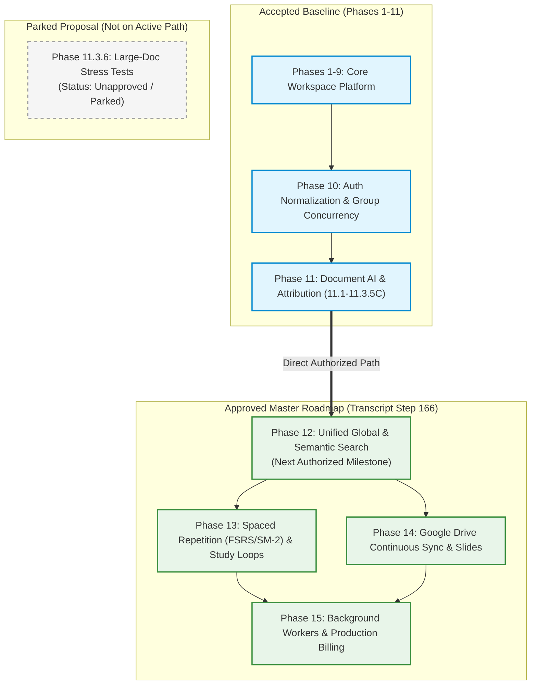

# Zenote — Master Development Roadmap & Cumulative Execution Checklist

> **Canonical Development Roadmap & Verification Record**  
> **Status:** Authoritative Baseline Reference  
> **Historical Provenance:** Master architecture plan established at **Transcript Step 166**; refined following completion and acceptance of **Phase 11.3.5C**.

---

## 1. Operating Rules & Roadmap Continuity Protocol

To prevent roadmap fragmentation, premature phase advancement, and unverified assumptions, all future development in Zenote must adhere to this protocol:

1. **Consult the Roadmap First:** At the beginning of every development turn, consult this document (`docs/ROADMAP.md`). Continue strictly from the next approved, incomplete milestone or task.
2. **Distinguish Status Dimensions:** A milestone's lifecycle is tracked across four distinct, non-fungible dimensions:
   - **Roadmap Approval:** Whether the task is an authorized project milestone (e.g. approved at Step 166).
   - **Implementation:** Whether source code exists in the repository addressing the requirements.
   - **Verification:** Whether automated test suites, typechecks, and benchmarks have executed and passed.
   - **Formal Acceptance:** Whether the user has formally reviewed and signed off on the completed milestone. Approval to undertake a milestone is not acceptance of its implementation.
3. **No Unilateral Phase Inventions:** A coding agent must never invent a new phase, subphase, or candidate workstream. Parked or unapproved proposals (e.g. Phase 11.3.6) must remain explicitly classified as **Unapproved / Parked / Not on the active execution path**.
4. **Preserve Accepted Safety Contracts:** Never weaken, bypass, or downgrade previously accepted safety guarantees (e.g. missing-geometry fail-closed behavior, atomic group deletion locks, source-unit attribution guards).
5. **Preserve the Limitations Register:** Never delete or conceal an entry in the Known Limitations & Verification Gaps register. An item may only be marked closed when concrete test or source evidence proves it resolved.
6. **Ground All Claims in Evidence:** Always cite exact file paths, exported symbols, test files, migration timestamps, Git commit hashes, and transcript references. Distinguish between Prisma declarations, migration SQL files, and live database inspections.

---

## 2. Product Vision & Architecture Baseline

### 2.1 Core Product Vision
Zenote is an **AI-powered lecture intelligence, curriculum-structured note-taking, and collaborative knowledge platform**. It bridges raw academic inputs (lecture audio recordings, uploaded PDFs, slide decks, Word documents, and Google Drive materials) into highly structured, verifiable study notes, interactive study loops, and multi-turn Socratic tutoring.

### 2.2 Core Hierarchy & Entity Structure
Zenote strictly organizes knowledge around an academic curriculum tree:
```
Workspace (Personal or Collaborative Group)
  └── Subject (Course / Academic Discipline)
        └── Chapter (Major Syllabus Unit)
              └── Topic (Discrete Lecture / Conceptual Topic)
                    ├── Notes (Rich-text Tiptap notes with structured NoteBlocks)
                    ├── Materials (Uploaded files: PDF, PPTX, DOCX, Audio, Video, Google Docs)
                    ├── FlashcardDecks (AI-generated or manual flip cards)
                    └── Quizzes (AI-generated multiple-choice mastery assessments)
```

### 2.3 Major Workflows
1. **Document & Audio Ingestion:** Multi-format ingestion with file validation, cloud storage (local disk or S3/R2), and local text extraction (`src/lib/document-extraction.ts`).
2. **Audio Transcription:** Pluggable speech-to-text service supporting AssemblyAI (speaker diarization) and OpenAI Whisper with synchronized audio playback seeking (`src/lib/services/speech.ts`).
3. **Deterministic Chunking & Embedding:** Word-count window text chunking (220 words / 40 word overlap) with 1536-dimensional vector embedding generation (`text-embedding-3-small`) persisted to PostgreSQL `pgvector` (`src/lib/chunking.ts`, `src/lib/ingestion.ts`).
4. **Scoped Vector Retrieval (RAG):** Cosine-distance vector similarity search strictly scoped by workspace, subject, or group boundary via `src/lib/retrieval.ts`.
5. **Document AI Note Synthesis:** Structured educational note generation powered by Google Gemini (`gemini-2.5-flash-lite`) enforcing the `NOTE_BLOCKS_SCHEMA` JSON schema with repair passes and content bounding (`src/lib/services/ai-gemini.ts`).
6. **Source Attribution & Grounding:** Deterministic physical page-level (PDF) and slide-level (PPTX) citation tracking with application-side normalized lexical presence verification.
7. **Study Loops & Collaboration:** Flashcard confidence tracking, multiple-choice quiz scoring, role-based access control (`OWNER`, `ADMIN`, `MEMBER`, `VIEWER`), and encrypted Google Drive connectivity.

### 2.4 Architecture & Integrations
- **Monolithic Next.js 14 App Router:** Unified deployable combining React 18 UI components, NextAuth JWT session handling, REST API route handlers (`src/app/api/`), and background job runners.
- **Relational & Vector Colocation:** PostgreSQL 15+ schema utilizing `pgvector`. Relational entities and vector embeddings reside in a single database to eliminate dual-write hazards.
- **Interface-First Service Layer:** All external capabilities are isolated behind strict TypeScript interfaces (`AIService`, `EmbeddingService`, `SpeechService`, `StorageService`, `DocumentProcessingService`).
- **Centralized Security Guard:** All data operations enforce tenant isolation and ownership verification through `assertCanAccess()` in `src/lib/access.ts`. "Never fake a feature."

---

## 3. Historical Roadmap & Phased Completion Record

| Phase / Subphase | Descriptive Title | Roadmap Approval | Implementation Status | Verification Status | Formal Acceptance | Key Commit / Evidence Reference |
| :--- | :--- | :--- | :--- | :--- | :--- | :--- |
| **Phases 1–9** | Core Workspace Platform Foundation | Approved | Completed | Verified (86 files, 875 tests) | Accepted | Commits `95fc757`, `3a1bb85`, `93f91f2` |
| **Phase 10A** | Auth Normalization & Edge Matchers | Approved | Completed | Verified | Accepted | Commit `1f7a8dc`; protected route tests |
| **Phase 10B** | Live Dashboard AI Widget & Real Members | Approved | Completed | Verified | Accepted | Commit `18eeca8`; `prisma.studyGroupMember` |
| **Phase 10C** | Group Deletion Concurrency Safety | Approved | Completed | Verified | Accepted | Commit `9981ea4`; interactive transaction |
| **Phase 11.0** | Document AI Architecture Audit | Approved | Completed | Verified | Accepted | Step 2387 architecture audit report |
| **Phase 11.1** | Backend Document AI Note Generation | Approved | Completed | Verified | Accepted | `POST /api/materials/[id]/generate-notes` |
| **Phase 11.2** | Frontend Document Note Generation Modal | Approved | Completed | Verified | Accepted | `document-note-modal.tsx` |
| **Phase 11.3.1** | Real Document Parser Test Harness | Approved | Completed | Verified | Accepted | `document-extraction.test.ts` passing |
| **Phase 11.3.2** | Gemini Schema Validation & JSON Repair | Approved | Completed | Verified | Accepted | `NOTE_BLOCKS_SCHEMA`; repair passes |
| **Phase 11.3.3** | Extraction Resource Protection & Queue | Approved | Completed | Verified | Accepted | `task-queue.ts`; FIFO concurrency bounds |
| **Phase 11.3.4** | PPTX Slide-by-Slide Extraction | Approved | Completed | Verified | Accepted | Slide boundary preservation tests |
| **Phase 11.3.5A** | PDF Single-Column Baseline Sort | Approved | Completed | Verified | Accepted | `pdf-layout-engine.ts` single-col tests |
| **Phase 11.3.5B.1**| Deterministic LTR Multi-Column Engine | Approved | Completed | Verified (205 layout tests) | Accepted | Step 9173; XY-cut fail-closed engine |
| **Phase 11.3.5C** | Page/Slide Attribution & Quote Grounding| Approved | Completed | Verified (122 AI tests) | Accepted | Steps 9750–9817; normalized lexical matching |
| **Phase 11.3.6** | Large-Document Stress Test Harness | **Unapproved / Parked**| Not Started | Not Verified | Not Accepted | Proposed Step 3329; not on active path |

---

## 4. Approved Remaining Master Roadmap (Phases 12–15)



---

### Phase 11.3.6: Large-Document Stress Test Suite (Unapproved / Parked)
- **Status:** **UNAPPROVED / PARKED / NOT ON THE ACTIVE EXECUTION PATH**.
- **Historical Provenance:** Proposed by an agent in Step 3329 during the Phase 11.3.0 architecture audit. Never formally authorized, scoped, or contracted by the user.
- **Active Path Clarification:** Phase 12 was independently authorized at Transcript Step 166. Phase 11.3.6 is **not** an approved prerequisite for Phase 12, nor is user authorization required to proceed without it. Phase 12 proceeds directly from accepted Phase 11.3.5C.

---

### Phase 12: Unified Global & Semantic Search (Authorized Core Milestone)
- **Status:** **COMPLETE** (Authorized at Transcript Step 166; Completed, Audited & Formally Accepted on November 11, 2026).
- **Objective:** Upgrade the existing basic string search (`src/app/api/search/route.ts`) into a unified, hybrid search engine combining PostgreSQL full-text search (lexical) with `pgvector` embeddings (semantic) across authorized entities.
- **Search Modality Matrix by Entity:**

| Entity Category | Core Scope Status | Existing Lexical Support | Existing Embedding Support | Planned Lexical Coverage | Planned Semantic Coverage | Embedding Generation Work Required |
| :--- | :--- | :--- | :--- | :--- | :--- | :--- |
| **1. Subjects** | Approved Core (Hierarchy) | Prisma `contains: q, mode: "insensitive"` in `GET /api/search` on `name`, `description` | None | PostgreSQL full-text search (tsvector / GIN) across `name` and `description` | Not planned for vector search (small discrete metadata entity; handled via lexical + hierarchy filter) | None |
| **2. Chapters** | Approved Core (Hierarchy) | Prisma `contains: q, mode: "insensitive"` in `GET /api/search` on `name`, `description` | None | PostgreSQL full-text search (tsvector / GIN) across `name` and `description` | Not planned for vector search (discrete metadata entity; handled via lexical + hierarchy filter) | None |
| **3. Topics** | Approved Core (Hierarchy) | Prisma `contains: q, mode: "insensitive"` in `GET /api/search` on `name`, `description` | None | PostgreSQL full-text search (tsvector / GIN) across `name` and `description` | Not planned for vector search (discrete metadata entity; handled via lexical + hierarchy filter) | None |
| **4. Materials** | Approved Core (Content) | None (Only status/metadata filtered in routes; no global search) | Supported for chunks (`MaterialChunk.embedding vector(1536)`) | Full-text search (tsvector / GIN) across `title` and `extractedText` | Scoped cosine similarity vector retrieval via `MaterialChunk.embedding` | Existing pipeline (`src/lib/ingestion.ts`) already generates embeddings on upload/transcription |
| **5. Notes** | Approved Core (Content) | None (Only topic-scoped note queries exist; no global search) | None (No vector columns on `Note` or `NoteBlock`) | Full-text search (tsvector / GIN) across `title` and rich-text note content (`NoteBlock.content`) | Scoped cosine similarity vector retrieval via `NoteChunk.embedding` | **Implemented**: transactional `NoteChunk` pipeline with `plainText` extraction, SHA-256 deduplication hashing, and advisory locking |
| **6. StudyGroups** | Approved Core (Collaboration) | None (Only user group membership queries exist; no global search) | None | Full-text search (tsvector / GIN) across group `name` and `description` | Evaluated in design review: low-volume metadata entity handled via lexical indexing and role authorization | None |
| **[Resolved] 7. Flashcards** | Included Lexical Scope (`FlashcardDeck` + `Flashcard`) | None (Deck-scoped queries only) | None | Full-text search across deck `title` (`idx_flashcard_deck_search_fts` weight `'A'`) and card-level `front` (`'B'`) / `back` (`'C'`) (`idx_flashcard_search_fts`) | Reserved for vector review sessions | None; decks and card `front`/`back` indexed lexically (Phase 12 + Phase 13 `LIM-10` resolution) |

- **Architectural Scope Decision — FlashcardDecks vs Quizzes:**
  - `FlashcardDeck` entities are included in Phase 12 search scope for lexical retrieval over deck `title` (weight `'A'`, indexed by `idx_flashcard_deck_search_fts`), respecting personal workspace, owner, and study-group access boundaries (`FlashcardDeck` schema contains `title`, not `description`).
  - `Quiz` entities are formally excluded from Phase 12 search (requests with `types=quiz` explicitly return HTTP 400 Bad Request: *"Entity type 'quiz' is formally excluded from Phase 12 search"*). Quiz search and evaluation workflows are reserved for Phase 13 study loops.

- **Retrieval Architecture & Verified Implementation:**
  - **Lexical Search (`src/lib/search/lexical-search.ts`):** PostgreSQL full-text search using `tsvector` and `websearch_to_tsquery` via expression GIN indexes across all 7 supported entities (`Subject`, `Chapter`, `Topic`, `Material`, `Note`, `Group`, `FlashcardDeck`).
  - **Semantic Vector Search (`src/lib/search/vector-search.ts`):** High-dimensional vector cosine distance search (`1 - (embedding <=> queryVector)`) using `pgvector` with HNSW indexing (`USING hnsw (embedding vector_cosine_ops)`) on `MaterialChunk` and `NoteChunk`. Graceful fallback to lexical search when embedding service is unconfigured or unavailable.
  - **Note Chunking & Lifecycle (`src/lib/search/note-embedding.ts`):** ProseMirror JSON block extraction to `Note.plainText` via `extractPlainTextFromTiptap` and `buildNotePlainText`. Deterministic word-window chunking (220 words / 40 word overlap) into `NoteChunk` records with SHA-256 hash checking to avoid redundant OpenAI API calls, transactional advisory locks (`pg_advisory_xact_lock`), stale vector overwrite protection, and automated stale chunk invalidation across all Note mutation paths (`getOrCreateTopicNote`, `PUT /api/notes/[noteId]/blocks`, `PATCH /api/notes/[noteId]`, `DELETE /api/notes/[noteId]`, `POST /api/notes/[noteId]/versions/[versionId]/restore`, `runNoteGenerationJob`, and `backfillNotesSearchIndex`).
  - **Hybrid Fusion (`src/lib/search/rrf-ranking.ts`):** Reciprocal Rank Fusion ($RRF(d) = \sum \frac{1}{k + r(d)}$ with constant $k=60$) merging lexical and vector candidate ranks. Entity chunk collapsing to parent entities with highest score attribution, and deep-link coordinate preservation (`?page=X` for PDFs, `?t=X` for audio materials, and `?tab=notes` for topic notes).
  - **Contextual Snippets (`src/lib/search/snippet-extractor.ts`, `src/components/search/highlighted-snippet.tsx`):** 160-character sliding-window match density extraction with word-boundary snapping and XSS-safe React token highlighting (`splitSnippetForHighlight` without `dangerouslySetInnerHTML`).
  - **Multi-Tenant Security Gating (`src/lib/search/search-access.ts`):** Strict fail-closed SQL WHERE clauses enforcing personal workspace boundaries, active study group memberships, and role-based permissions (`OWNER`, `ADMIN`, `MEMBER`, `VIEWER`). Soft-deleted records (`deletedAt IS NOT NULL`) are strictly excluded at query time across all ancestor levels.
  - **Authenticated API (`src/app/api/search/route.ts`) & Dedicated `/search` Page (`src/app/(app)/search/page.tsx`):** Validated route handler enforcing Zod parameter constraints, multi-format `types` parsing, NextAuth session verification (401 on unauthenticated), and standardized JSON response serialization (`SearchApiResponse`), paired with a full-featured `/search` page with entity facet pills (`SearchFacets`) and mode selector.
  - **Command Palette UI (`src/components/shell/command-palette.tsx`):** Keyboard-accessible global search palette (Cmd/Ctrl+K) with debounced live querying, `AbortController` request cancellation, loading/empty states, entity type icons, highlighted snippets, and deep-link navigation.

- **Verification Evidence (Reconciled Independent Audit — November 11, 2026):**
  - **Live PostgreSQL + pgvector Migration & Index Verification:** `prisma/migrations/20261110090000_phase12_search_indexing/migration.sql` applied via `prisma migrate deploy` on live Neon PostgreSQL 17 (`neondb`) with `vector` extension (`0.8.0`). All 2 HNSW indexes (`idx_material_chunk_embedding_hnsw`, `idx_note_chunk_embedding_hnsw`) and 7 expression GIN indexes verified in `pg_indexes` and via `EXPLAIN (ANALYZE, BUFFERS)`.
  - **Real PostgreSQL Integration Suite (`src/lib/search/__tests__/search-postgres-integration.test.ts`):** 9 comprehensive live-DB integration tests passing (catalog, `EXPLAIN (ANALYZE, BUFFERS)`, full Note embedding lifecycle across all mutation paths, multi-tenant authorization matrix, RRF ranking & deep links, and real PostgreSQL latency benchmarks).
  - **Search Unit, Adversarial, API & UI Suites:** 18 test files (363 tests passing).
  - **Search E2E Test Suite (`tests/e2e/search/`):** 37 test files (329 tests passing across 4 tiers + harness).
  - **Overall Repository Test Suite:** 164 test files passed (`164/164`), **2,060 tests passing**, 4 skipped external-key tests (`0` failures).
  - **TypeScript, Lint & Build:** `tsc --noEmit` clean (0 errors), `eslint .` clean (0 errors), `next build` clean (all 40 routes compiled).
- **Dependencies:** Phase 11.3.5C (source units and note blocks available for indexing).

---

### Phase 13: Spaced Repetition (FSRS/SM-2) & Study Loops (Approved Milestone)
- **Status:** **COMPLETE** (Authorized at Transcript Step 166; Implemented, Audited & Live-PostgreSQL Concurrency Verified on November 12, 2026; `AUD-13-01`, `AUD-13-02` & `AUD-13-05` closed).
- **Objective:** Implement automated spaced repetition scheduling for flashcard review sessions and active quiz assessment loops.
- **Scope & Verified Implementation:**
  - **Spaced Repetition Engine (`13-01` — `src/lib/srs/fsrs.ts`):** Pure, deterministic FSRS-4.5 DSR (Difficulty, Stability, Retrievability) interval mathematics ($w_0 \dots w_{16}$, target retention $R_0 = 0.90$, decay $w_{19} = 19/81$, factor $w_{20} = -0.5$) calculating initial/next stability $S$, difficulty $D \in [1, 10]$, retrievability $R(t,S)$, interval $I(S, R_0)$, and next due timestamp across `NEW`, `LEARNING`, `REVIEW`, `RELEARNING`, and `SUSPENDED` states, with IANA timezone day-boundary helpers (`Profile.timezone`, UTC fallback), interval previews (`previewSchedulingOptions`), and legacy binary `FlashcardReview` backward compatibility (`deriveCardStateFromReview`).
  - **Due Review Queue & Deck/Card APIs (`13-02` — `src/lib/srs/study-queue.ts`, `src/lib/srs/due-service.ts`, `src/app/api/flashcards/due/route.ts`, `src/app/api/flashcards/[deckId]/reviews/route.ts`, `src/app/api/flashcards/[deckId]/cards/route.ts`):** Daily review queue computation and deterministic partitioning (`LEARNING`/`RELEARNING` due $\rightarrow$ `REVIEW` due $\rightarrow$ `NEW` cards) with aggregate and per-deck statistics (`dueCount`, `overdueCount`, `newCount`, `learningCount`, `reviewCount`, `suspendedCount`, `upcoming7DaysCount`), transactional review persistence with per-card PostgreSQL advisory locking (`pg_advisory_xact_lock(hashtextextended('flashcard_review:' || userId || ':' || flashcardId, 0))`), `idempotencyKey` (`@@unique([userId, idempotencyKey])`) with `P2002` race recovery and `409 IDEMPOTENCY_KEY_CONFLICT` validation (`AUD-13-02`), card `SUSPEND`/`UNSUSPEND` actions (`rating: null`), card/deck CRUD, and `GET /api/topics/[topicId]/flashcards` + `GET /api/topics/[topicId]/quizzes`.
  - **Interactive Flashcard Review UI (`13-03` — `src/components/flashcards/flashcard-study-view.tsx`, `src/components/flashcards/flashcard-deck-view.tsx`, `src/components/flashcards/flashcard-deck-page.tsx`):** 4-point FSRS-4.5 rating buttons (`Again: 1`, `Hard: 2`, `Good: 3`, `Easy: 4`, `Flip: Space`) with live next-interval previews (`<10m`, `1d`, `2d`, `6d`, etc.), queue mode selector (`Due & New` vs `All Cards`), progress bar, suspend/unsuspend controls, session completion summary with rating breakdown, and inline card/deck management.
  - **Quiz Assessment Runner, Mastery & Progress Analytics (`13-04` — `src/lib/study-progress.ts`, `src/components/quizzes/quiz-taking-view.tsx`, `src/components/topics/study-progress-panel.tsx`, `src/components/dashboard/study-activity-widget.tsx`):** Server-authoritative quiz scoring, immediate retake workflow, `computeQuizMastery` tiers (`NONE`, `DEVELOPING`, `PROFICIENT`, `MASTERED`) with `uniqueQuizzesAttempted` calculated across the complete authorized attempt set (`AUD-13-05`), and `getFlashcardProgress` rollups excluding pure `SUSPEND`/`UNSUSPEND` lifecycle events (`isPureLifecycleReviewEvent`, `AUD-13-01`) from review-history aggregates while preserving `latestByCardId` and `suspendedCount`.
  - **Card-Level Lexical Search Integration (`LIM-10` Resolution — `src/lib/search/lexical-search.ts`, `20261111180000_phase13_intelligent_study_system`):** Expression GIN index `idx_flashcard_search_fts` on `"Flashcard"` (`front` weight `'B'`, `back` weight `'C'`) and `LEFT JOIN LATERAL` in `queryFlashcards` matching card-level `front`/`back` content and collapsing hits to the parent `FlashcardDeck` with card snippet text.
- **Verification Evidence (November 12, 2026):**
  - **Live PostgreSQL 17 & 18.6 Migration & Integration:** All 11 repository migrations (including `20261110090000_phase12_search_indexing` and `20261111180000_phase13_intelligent_study_system`) applied cleanly via `prisma migrate deploy` on the isolated `zenote_phase13_test` PostgreSQL 18.6 (`pgvector 0.8.6`) database; all 5 live-PostgreSQL integration tests (`5/5` passed, `0` skipped) in `src/lib/srs/__tests__/study-postgres-integration.test.ts` verified FSRS-4.5 state transitions, timezone due queues, multi-user isolation, `pg_advisory_xact_lock` concurrency serialization, `P2002` / `409 IDEMPOTENCY_KEY_CONFLICT` enforcement, transaction rollback, independent-card concurrency, and direct `POST /api/flashcards/[deckId]/reviews` route execution.
  - **Phase 13 Final Acceptance Audit & Targeted Corrections (`AUD-13-01`, `AUD-13-02`, `AUD-13-05`):**
    - `AUD-13-01` (**Closed**): Pure `SUSPEND`/`UNSUSPEND` lifecycle rows (`state === "SUSPENDED" || stateBefore === "SUSPENDED"`) persist `rating: null` and are excluded via `isPureLifecycleReviewEvent` from historical review counts, `cardsStudied`, accuracy, rating distributions, `lastReviewedAt`, and daily activity in `getFlashcardProgress` while preserving `latestByCardId` and `suspendedCount` (`src/lib/__tests__/study-progress.test.ts` and Test 5 of `study-postgres-integration.test.ts`).
    - `AUD-13-05` (**Closed**): `QuizProgress.uniqueQuizzesAttempted` (required `number`) is computed across the complete authorized attempt set via `groupBy`/`aggregate` (and pre-slice full-list fallback in lightweight mocks) while retaining the 20-item `history` UI payload cap, and `computeQuizMastery` throws if `uniqueQuizzesAttempted` is omitted when `attempts > history.length` (`src/lib/__tests__/study-progress.test.ts`).
    - `AUD-13-02` (**Closed — Verified in Both Hermetic & Isolated Live-PostgreSQL Concurrency Suites**): Per-card `pg_advisory_xact_lock`, monotonic review timestamps, `P2002` transaction-abort recovery, and `409 IDEMPOTENCY_KEY_CONFLICT` verification in `src/app/api/flashcards/[deckId]/reviews/route.ts` verified across 25 hermetic route tests (`route.test.ts`) and 5 live PostgreSQL 18.6 integration tests (`study-postgres-integration.test.ts` Tests 1–5 against `zenote_phase13_test`, without touching shared `/neondb`).
  - **Automated Test Suite:** 168 non-shared-DB test files passed (`2,123` tests passing, `0` failures) plus `5/5` live PostgreSQL integration tests in `src/lib/srs/__tests__/study-postgres-integration.test.ts`.
  - **TypeScript, Lint & Build:** `tsc --noEmit` clean (0 errors), `eslint .` clean (0 errors), `next build` clean (all 43 routes compiled).
- **Dependencies:** Phase 12 (search and discovery of study decks).

---

### Phase 14: Google Drive Continuous Sync & Native Slides (Approved Milestone)
- **Status:** **COMPLETE** (Authorized at Transcript Step 166; Implemented, Verified & Documented on November 13, 2026).
- **Objective:** Transition Google Drive from manual one-off importing to a continuous synchronization pipeline with native Google Slides parsing and bidirectional Google Docs synchronization.
- **Scope & Verified Implementation:**
  - **Google Drive Push Webhook Receiver, Watch-Channel Lifecycle & Incremental Changes API Sync (`14-01` — `src/lib/google-drive-sync.ts`, `src/app/api/integrations/google/webhook/route.ts`, `src/app/api/integrations/google/sync/route.ts`, `src/lib/services/google-drive.ts`, `src/lib/google-connection.ts`):**
    - Push notification receiver at `POST /api/integrations/google/webhook` authenticating `X-Goog-Channel-ID`, `X-Goog-Resource-ID`, `X-Goog-Resource-State`, `X-Goog-Message-Number`, and constant-time HMAC-SHA256 verification (`crypto.timingSafeEqual`) of `X-Goog-Channel-Token` against `ConnectedAccount.watchTokenHash` (raw tokens are never stored in plaintext).
    - Monotonic `lastWebhookMessageNumber` (`BigInt`) tracking to suppress duplicate or out-of-order delayed webhook notifications idempotently, plus `sync` handshake acknowledgment.
    - Watch-channel lifecycle management (`ensureDriveWatchChannel`, `renewExpiringWatchChannels`, and best-effort `stopWatchChannel` + state clearing on `disconnectGoogleAccount`).
    - Incremental change detection via Google Drive Changes API (`getStartPageToken`, `listChanges`, `watchChanges`, `stopWatchChannel`, `getFileSyncMetadata`), deduplicating multiple edits to the same `fileId` within a sync window, skipping unchanged files idempotently, marking trashed/deleted remote files as `REMOTE_DELETED` without deleting the user's Zenote `Material` or `Note`, and recovering from expired `pageToken` (`HTTP 410 Gone` / `GoogleInvalidPageTokenError`) via targeted metadata checks on tracked materials and notes (never scanning the user's full Drive).
    - Per-user in-process token refresh coalescing (`getValidGoogleAccessToken`) and revoked-grant (`400`/`401` `invalid_grant`) detection marking `ConnectedAccount.syncStatus = "RECONNECT_REQUIRED"`.
  - **Native Google Slides v1 REST API Parser (`14-02` — `src/lib/services/google-slides.ts`, `src/lib/google-file-classifier.ts`, `src/lib/google-import.ts`, `src/components/materials/google-doc-viewer.tsx`, `src/components/materials/material-preview.tsx`):**
    - Direct Google Slides v1 REST API extraction (`GET https://slides.googleapis.com/v1/presentations/{presentationId}`) without downloading or converting through PPTX.
    - Preserves `presentationId`, `title`, `revisionId`, 1-based slide numbers (`pageNumber: 1..N`), slide titles/subtitles (`TITLE`, `CENTERED_TITLE`, `SUBTITLE` ordered ahead of body blocks), body shapes, TSV table rows/cells, nested `elementGroup` hierarchies (bounded at `MAX_SLIDES_SHAPE_GROUP_DEPTH = 20`), and speaker notes (`notesPage.notesProperties.speakerNotesObjectId` + `BODY` placeholder fallback).
    - Populates `Material.extractedText` and 1-based `Material.extractedPages` (`[{ pageNumber, text, slideText, speakerNotes }]`) for full compatibility with Phase 11 grounded AI note generation (`formatDelimitedSourceText(..., "slide")`), Phase 12 hybrid search (`chunkPagedText` -> `MaterialChunk.pageNumber`), and interactive slide-by-slide preview (`GoogleDocViewer`).
  - **Bidirectional Google Docs Export & Synchronization (`14-03` — `src/lib/services/google-docs.ts`, `src/lib/google-note-sync.ts`, `src/app/api/notes/[noteId]/google-sync/route.ts`, `src/components/notes/note-editor.tsx`):**
    - Exports Zenote `Note`s (Title + ordered `NoteBlock`s) to Google Docs via the Google Docs v1 REST API (`createGoogleDocument`, `batchUpdateGoogleDocument`, `getGoogleDocument`) and tracks sync state in `Note.externalRef` (`documentId`, `webViewLink`, `revisionId`, `modifiedTime`, `lastSyncedLocalHash`, `lastSyncedRemoteHash`, `lastSyncedAt`, `syncStatus`, `conflict`).
    - Supports pushing local Zenote edits to the linked Google Doc (guarded by `writeControl.requiredRevisionId` and `pg_advisory_xact_lock`) and pulling remote Google Doc edits back into Zenote `NoteBlock`s (automatically snapshotting prior blocks into `NoteVersion` and updating Phase 12 hybrid search via `syncNoteSearchIndex`).
    - Suppresses webhook/sync echo loops via canonical SHA-256 content hashes (`computeCanonicalNoteSyncHash`) and detects concurrent local + remote divergence as an explicit `409 CONFLICT` state with user-controlled resolution (`keep_local` vs `accept_remote`).
- **Verification Evidence (November 13, 2026):**
  - **Database Migration (`20261112223000_phase14_google_drive_sync_and_slides`):** Verified and applied cleanly via `prisma migrate deploy` and `prisma migrate status` on the isolated `zenote_phase13_test` PostgreSQL 18.6 (`pgvector 0.8.6`) database (`12` migration directories in `prisma/migrations` matching `12` applied rows in `_prisma_migrations`, `0` pending) without touching the shared `/neondb` database.
  - **Phase 14 Automated Test Suites (Mocked Google API Boundary):** 14 Phase 14 Google integration/unit/route/validation test files passed (`0` skipped, `0` failed; **109 passed tests, 0 skipped, 0 failed**: 13 service/sync/route suites with `100` passed tests + 1 Zod validation suite `src/lib/validation/__tests__/google.test.ts` with `9` passed tests), covering `google-drive.test.ts` (21), `google-file-classifier.test.ts` (16), `google-reliability.test.ts` (12), `google-drive-sync.test.ts` (9), `google-note-sync.test.ts` (9), `validation/__tests__/google.test.ts` (9), `callback/__tests__/route.test.ts` (6), `google-slides.test.ts` (5), `google-oauth.test.ts` (5), `google-oauth-state.test.ts` (5), `google-connection.test.ts` (4), `google-docs.test.ts` (4), `webhook/__tests__/route.test.ts` (2), and `notes/[noteId]/google-sync/__tests__/route.test.ts` (2). *(Including the pre-existing `src/lib/__tests__/google-errors.test.ts` with `17` tests yields **15 Google-related test files / 126 passing tests** repository-wide.)*
  - **Repository-Wide Test Suite, Typecheck, Lint & Build:**
    - *Default Hermetic Run (`ISOLATED_TEST_DATABASE_URL` unset):* **174 passed test files, 2 skipped test files (`176` total files); 2,162 passed tests, 19 skipped tests (`2,181` total tests), 0 failed** (the 19 skipped tests consist of the 15 live-PostgreSQL integration tests across the 2 skipped live-DB files plus 4 opt-in stress benchmark tests).
    - *Separate Isolated Live-PostgreSQL 18.6 Runs (`zenote_phase13_test`):* **2 passed test files, 0 skipped; 15 passed tests, 0 skipped, 0 failed** (`study-postgres-integration.test.ts`: `5` passed; `search-postgres-integration.test.ts`: `10` passed).
    - *Static Verification:* `tsc --noEmit` clean (0 errors), `eslint .` clean (0 errors), `next build` clean.
  - **Live External Google API & Webhook Delivery Status:** **BLOCKED** (`0` live Google API or live webhook tests executed) due to missing external prerequisites in the local test environment (`ConnectedAccount count = 0` in `zenote_phase13_test`, no dedicated test Google account OAuth refresh token or test Drive/Docs/Slides fixture IDs provisioned, `NEXTAUTH_URL = http://127.0.0.1:3000`, and `GOOGLE_DRIVE_WEBHOOK_URL` unset; see `LIM-17` and `LIM-18`).
- **Dependencies:** Phase 12 (auto-indexing synced documents and notes into hybrid search).

---

### Phase 15: Background Worker Architecture & Production Billing (Approved Milestone)
- **Status:** **COMPLETE** (Authorized at Transcript Step 166; Implemented, Verified & Documented on November 13, 2026).
- **Objective:** Extract long-running audio transcription, document extraction, vector embedding, AI note synthesis, and Google Drive synchronization into a durable BullMQ/Redis background job architecture with PostgreSQL state persistence, real-time Server-Sent Events (SSE) progress streaming, crash-safe recovery (`LIM-18` closure), and Stripe subscription billing.
- **Scope & Verified Implementation:**
  - **Redis & BullMQ Worker Infrastructure (`15-01` — `src/lib/queue/connection.ts`, `src/lib/queue/dispatcher.ts`, `src/lib/queue/worker.ts`, `src/lib/queue/reconciliation.ts`, `src/lib/queue/events.ts`, `src/lib/queue/index.ts`, `src/workers/index.ts`, `prisma/migrations/20261113210000_phase15_durable_jobs_and_billing`):**
    - Unified TCP/TLS Redis connection factory (`src/lib/queue/connection.ts`) resolving `BULLMQ_REDIS_URL`, `REDIS_URL`, or automatically deriving TLS TCP `rediss://default:<token>@<upstash-host>:6379` from `UPSTASH_REDIS_REST_URL` + `UPSTASH_REDIS_REST_TOKEN` (unless `BULLMQ_DISABLE_UPSTASH_TCP=true`), while preserving `UPSTASH_REDIS_REST_URL` HTTP REST rate limiting in `src/lib/rate-limit.ts`.
    - PostgreSQL `ProcessingJob` remains the canonical durable state ledger (`attempts`, `maxAttempts`, `workerId`, `queueJobId`, `updatedAt`, `@@index([status, createdAt])`), while BullMQ (`zenote-processing-jobs`) acts as the distributed dispatch plane with deterministic deduplication (`jobId = "${type}:${jobId}"`) and seamless in-process execution fallback when TCP Redis is disabled (`BULLMQ_ENABLED=false` or hermetic unit tests without `ENABLE_LIVE_BULLMQ_TESTS=true`).
    - Standalone worker entrypoint (`npm run worker` -> `tsx src/workers/index.ts`) and configurable worker runtime (`startProcessingWorker`) with Upstash Free Tier command conservation (`stalledInterval: 60_000`, `drainDelay: 30`, producer `removeOnComplete: { age: 24 * 3600, count: 200 }`, `removeOnFail: { age: 7 * 24 * 3600, count: 500 }`), exponential backoff (`2000ms` base), bounded concurrency, recurring reconciliation (`5` min), watch-renewal (`6` hours), and retention (`24` hours) intervals, and graceful `SIGTERM`/`SIGINT` shutdown.
    - Readiness probe integration in `GET /api/health` (`checks.queue`: `ok` / `degraded`) reporting `checkQueueHealth()` telemetry without leaking connection URLs or credentials.
  - **Asynchronous Task Offloading & `LIM-18` Full Closure (`15-02` — `src/lib/queue/dispatcher.ts`, `src/lib/queue/reconciliation.ts`, `src/lib/google-drive-sync.ts`, `src/lib/google-import.ts`, `src/lib/google-note-sync.ts`, `src/instrumentation.ts`):**
    - Migrated all 5 `ProcessingJobType` workloads (`DOCUMENT_EXTRACTION`, `TRANSCRIPTION`, `EMBEDDING`, `AI_NOTE_GENERATION`, `GOOGLE_SYNC`) through `dispatchProcessingJob()` (`src/app/api/materials/[materialId]/transcribe/route.ts`, `src/app/api/materials/[materialId]/generate-notes/route.ts`, `src/lib/document-extraction.ts`, `src/lib/ingestion.ts`, `src/lib/google-import.ts`, `src/lib/google-drive-sync.ts`) while preserving synchronous `awaitImportJobs !== false` modes for deterministic route/unit tests.
    - **Closed `LIM-18` Part 1 (Stranded `GOOGLE_SYNC` & All `ProcessingJob` Recovery):** `reconcileStrandedProcessingJobs()` recovers stranded `QUEUED` (`>= 30s` via `DEFAULT_QUEUED_STRANDED_MS = 30_000`) and stale `RUNNING` (`>= staleAfterMs(type)`) jobs across all 5 job types, increments `attempts`, re-dispatches recoverable jobs (`attempts + 1 <= maxAttempts`), fails exhausted jobs (`attempts + 1 > maxAttempts`) with `settleStrandedMaterial()` so `Material.status` never remains perpetually `PROCESSING`, and detects Google Drive `Material` rows stuck in `PROCESSING` without an active `GOOGLE_SYNC` job. Furthermore, `executeUserDriveSync` in `src/lib/google-drive-sync.ts` now stores incoming remote timestamps in `pendingModifiedTime`/`pendingRevisionId` while `syncStatus: "SYNCING"` and promotes `modifiedTime`/`revisionId` in `src/lib/google-import.ts` only after `runGoogleImportJob` succeeds.
    - **Closed `LIM-18` Part 2 (Crash-Safe Google Docs Initial Export Across Process Restarts):** `executeExportOrSyncNoteWithGoogleDocs` in `src/lib/google-note-sync.ts` persists a durable PostgreSQL checkpoint (`syncStatus: "EXPORTING"`, `documentId`, `webViewLink`, `revisionId`) to `Note.externalRef` immediately after `createGoogleDocument()` and **before** `batchUpdateGoogleDocument()`. If `batchUpdateGoogleDocument()` fails and the Node.js process crashes or restarts (wiping all in-memory maps), a subsequent retry reads the persisted `EXPORTING` `documentId` from PostgreSQL and populates the existing Google Doc rather than creating an orphan duplicate.
    - **Closed `LIM-18` Part 3 (Unattended Watch-Channel Renewal):** `runScheduledWatchChannelRenewal()` is scheduled on a recurring background interval (default every `6` hours via `DEFAULT_WATCH_RENEWAL_INTERVAL_MS = 6 * 60 * 60 * 1000` in `src/lib/queue/worker.ts`) to renew expiring Google Drive watch channels for idle accounts without requiring user or webhook traffic.
  - **Real-Time Job Progress Streams via Server-Sent Events (`15-03` — `src/lib/queue/events.ts`, `src/app/api/processing-jobs/stream/route.ts`, `src/app/api/processing-jobs/[jobId]/stream/route.ts`, `src/components/notes/generate-ai-notes-button.tsx`, `src/components/materials/material-transcribe-section.tsx`):**
    - Authenticated SSE endpoints (`GET /api/processing-jobs/stream` and `GET /api/processing-jobs/[jobId]/stream`) enforcing NextAuth session authentication (`401` on unauthenticated) and strict multi-tenant ownership/workspace/group RBAC (`getAccessibleProcessingJob`, `getAccessibleMaterial`, `403`/`404` on unauthorized access).
    - Emits `: connected` (echoing `Last-Event-ID` when present), initial PostgreSQL state snapshots and live updates as `event: job-status` (`data: {"job": ...}`) with per-process `id: <timestamp>-<seq>` (`QUEUED`, `RUNNING`, `SUCCEEDED`, `FAILED`, `CANCELLED`), cross-process PostgreSQL state synchronization every `2,500ms` (`DB_POLL_SYNC_INTERVAL_MS`) for `jobId`- and `materialId`-scoped streams, `: ping` keepalive comments every `15,000ms`, and clean stream closure on terminal status or `req.signal` abort. (No historical intermediate event log is persisted; reconnecting reconstructs the current PostgreSQL state snapshot).
    - Client UI integration (`GenerateAiNotesButton`, `MaterialTranscribeSection`) using `EventSource` for live `job-status` updates alongside a concurrent `3,000ms` HTTP polling fallback (`GET /api/processing-jobs/[jobId]` / `GET /api/materials/[materialId]`) if SSE is unavailable or closes on error.
  - **Stripe Subscription Billing, Customer Portal & Idempotent Webhooks (`15-04` — `src/lib/billing/stripe.ts`, `src/app/api/billing/subscription/route.ts`, `src/app/api/billing/checkout/route.ts`, `src/app/api/billing/portal/route.ts`, `src/app/api/billing/webhook/route.ts`, `src/components/settings/billing-panel.tsx`, `src/app/(app)/settings/page.tsx`):**
    - Extended `Subscription` (`externalSubscriptionId @unique`, `externalPriceId`, `billingInterval`, `cancelAtPeriodEnd`, `currentPeriodStart`, `canceledAt`, `lastWebhookEventAt`) and added `BillingWebhookEvent` (`externalEventId @unique`, `eventType`, `eventCreatedAt`, `status`, `userId`, `payloadHash`, `error`, `processedAt`) in `prisma/schema.prisma`.
    - Constant-time HMAC-SHA256 `Stripe-Signature` verification (`verifyStripeWebhookSignature` with `crypto.timingSafeEqual` and 300-second replay window) over raw request body bytes at `POST /api/billing/webhook`.
    - Idempotent, transactional webhook processor (`processStripeWebhookEvent`) handling `checkout.session.completed`, `customer.subscription.created`, `customer.subscription.updated`, `customer.subscription.deleted`, `invoice.payment_succeeded`, and `invoice.payment_failed`, deduplicating replays via `BillingWebhookEvent.externalEventId` (`status: "duplicate_ignored"`) and ignoring strictly older out-of-order events via `Subscription.lastWebhookEventAt` (`status: "ignored_stale"`).
    - Seamless integration with `src/lib/plans.ts` (`getPlanLimits`, `PLAN_LIMITS` for `FREE`, `STUDENT`, `PRO`, `TEAM`, and `INSTITUTION` across AI credits, storage bytes, recording minutes, and group members) and interactive Settings billing UI (`BillingPanel` in `/settings`).
- **Verification Evidence (November 13, 2026):**
  - **Database Migration (`20261113210000_phase15_durable_jobs_and_billing`):** Applied cleanly via `prisma migrate deploy` and verified via `prisma migrate status` on the isolated `zenote_phase13_test` PostgreSQL 18.6 (`pgvector 0.8.6`) database (`13` migration directories in `prisma/migrations` matching `13` applied rows in `_prisma_migrations`, `0` pending) without touching the shared `/neondb` database.
  - **Live Isolated PostgreSQL 18.6 + Live Upstash TLS TCP Redis Integration (`src/lib/__tests__/phase15-live-integration.test.ts`):** `4/4` live integration tests passed (`0` skipped, `0` failed) against `zenote_phase13_test` and live Upstash Redis (`prime-bluejay-312074.upstash.io:6379`), verifying: (1) durable `ProcessingJob` retry/exhaustion reconciliation & material settlement, (2) crash-safe Google Docs `EXPORTING` PostgreSQL checkpoint recovery after wiping in-memory maps, (3) transactional Stripe webhook persistence, duplicate replay suppression (`BillingWebhookEvent`), and out-of-order timestamp protection, and (4) live BullMQ Queue + Worker round-trip over Upstash TLS TCP Redis updating PostgreSQL `ProcessingJob` state.
  - **Phase 15 Unit & Route Suites:** `src/lib/__tests__/phase15-queue-and-reconciliation.test.ts` (`7` passed), `src/app/api/processing-jobs/stream/__tests__/route.test.ts` (`5` passed), `src/lib/__tests__/stripe-billing.test.ts` (`7` passed), plus updated `google-note-sync.test.ts` (`9` passed), `google-drive-sync.test.ts` (`9` passed), `google-reliability.test.ts` (`12` passed), `processing-jobs.test.ts` (`10` passed), `processing-jobs-isolation.test.ts` (`13` passed), and `api/health/__tests__/route.test.ts` (`19` passed).
  - **Repository-Wide Test Suite, Typecheck, Lint & Build:**
    - *Default Hermetic Run (`ISOLATED_TEST_DATABASE_URL` unset):* **177 passed test files, 3 skipped test files (`180` total files); 2,181 passed tests, 23 skipped tests (`2,204` total tests), 0 failed**.
    - *Separate Isolated Live-PostgreSQL 18.6 + Live Upstash Redis Runs (`zenote_phase13_test`):* **3 passed test files, 0 skipped; 19 passed tests, 0 skipped, 0 failed** (`phase15-live-integration.test.ts`: `4` passed; `study-postgres-integration.test.ts`: `5` passed; `search-postgres-integration.test.ts`: `10` passed).
    - *Static Verification:* `tsc --noEmit` clean (`0` errors), `eslint .` clean (`0` errors), `next build` clean (all static and dynamic routes compiled cleanly, including `/api/processing-jobs/stream`, `/api/processing-jobs/[jobId]/stream`, `/api/billing/subscription`, `/api/billing/checkout`, `/api/billing/portal`, and `/api/billing/webhook`).
- **Dependencies:** Phases 11–14 (all job payloads and pipelines stabilized).

---

## 5. Performance Targets & Numeric Criteria Audit

A previous draft included several numeric thresholds as prospective acceptance criteria. They are audited and classified below to ensure aspirational targets are not confused with verified production guarantees:

| Metric / Threshold | Provenance & Origin | Approved Requirement? | Measured by Benchmark? | Classification | Conditions & Action Required |
| :--- | :--- | :--- | :--- | :--- | :--- |
| **Search response $< 100\text{ms}$** | Assistant proposal in Step 9873 | No (Not in user prompt) | No benchmark exists | **Proposed Performance Target** | Target for Phase 12 design; test on dataset with 10k items. |
| **Memory overhead $\le 150\text{MB}$** | Assistant proposal in Step 9873 | No (Phase 11.3.6 unapproved) | No benchmark exists | **Proposed Performance Target** | Parked with Phase 11.3.6. |
| **Cancellation latency $\le 50\text{ms}$** | Assistant proposal in Step 9873 | No (Phase 11.3.6 unapproved) | No wall-clock test | **Proposed Performance Target** | Synchronous abort via `signal.throwIfAborted()` exists; measure wall-clock latency if benchmarked. |
| **10 concurrent 50MB PDFs in 200MB** | Assistant proposal in Step 9873 | No (Step 166 mentions BullMQ) | No benchmark exists | **Unsupported Target to Revise** | Revise to architectural requirement: "Worker memory decoupled from web server." |
| **200,000 Character Context Limit** | `src/lib/note-generation.ts` (`MAX_DOCUMENT_NOTE_GEN_CHARS`) | **Yes (Code & Spec)** | **Yes (Verified in Tests)** | **Approved Contractual Limit** | **Corrected:** Capped at 200,000 *characters* (~35,000 words, ~45,000–50,000 tokens), not tokens. |

---

## 6. Permanent Cumulative Execution Checklist

All tasks carry stable, permanent identifiers. Tasks marked **COMPLETED** are locked and verified.

| Task ID | Phase | Task Name & Description | Approval Status | Implementation Status | Verification Status | Acceptance Status | Prerequisites | Key Evidence / Condition |
| :--- | :--- | :--- | :--- | :--- | :--- | :--- | :--- | :--- | :--- |
| **10A-01** | 10A | Auth route normalization & edge matchers | Approved | Completed | Verified | Accepted | Phase 9 | Commit `1f7a8dc` |
| **10B-01** | 10B | Dashboard live AI processing widget | Approved | Completed | Verified | Accepted | 10A-01 | Commit `18eeca8` |
| **10B-02** | 10B | Study group member list DB integration | Approved | Completed | Verified | Accepted | 10A-01 | Commit `18eeca8` |
| **10C-01** | 10C | Group deletion concurrency & lock | Approved | Completed | Verified | Accepted | 10B-02 | Commit `9981ea4` |
| **11.1-01**| 11.1| Backend document extraction pipeline | Approved | Completed | Verified | Accepted | Phase 10 | `document-extraction.ts` |
| **11.1-02**| 11.1| Gemini structured note generation | Approved | Completed | Verified | Accepted | 11.1-01 | `ai-gemini.ts` |
| **11.2-01**| 11.2| Frontend document note modal flow | Approved | Completed | Verified | Accepted | 11.1-02 | `document-note-modal.tsx` |
| **11.3-01**| 11.3.1| Real document parser fixture test harness| Approved | Completed | Verified | Accepted | 11.1-01 | `document-extraction.test.ts` |
| **11.3-02**| 11.3.2| Gemini schema validation & JSON repairs | Approved | Completed | Verified | Accepted | 11.1-02 | `NOTE_BLOCKS_SCHEMA` |
| **11.3-03**| 11.3.3| Extraction memory guards & FIFO queue | Approved | Completed | Verified | Accepted | 11.3-01 | `task-queue.ts` |
| **11.3-04**| 11.3.4| PPTX slide-by-slide structural extraction| Approved | Completed | Verified | Accepted | 11.3-01 | Slide boundary unit tests |
| **11.3-05**| 11.3.5A| PDF single-column baseline sort | Approved | Completed | Verified | Accepted | 11.3-01 | `pdf-layout-engine.ts` tests |
| **11.3-06**| 11.3.5B| Multi-column XY-cut reading order engine| Approved | Completed | Verified | Accepted | 11.3-05 | 205 layout tests passing |
| **11.3-07**| 11.3.5B| Missing-geometry fail-closed safety | Approved | Completed | Verified | Accepted | 11.3-06 | Multi-item geometry tests pass |
| **11.3-08**| 11.3.5C| Page/slide attribution & quote grounding| Approved | Completed | Verified | Accepted | 11.3-07 | 122 AI generation tests pass |
| **11.3.6-01**| 11.3.6| Multi-page physical stress test suite | **Parked** | Not Started | Not Verified | Not Accepted | 11.3-08 | Not on active path |
| **12-01** | 12 | Database & Indexing Design Review | Approved | **Completed** | **Verified** | **Accepted** | 11.3-08 | `20261110090000_phase12_search_indexing`, live `pg_indexes` & `EXPLAIN ANALYZE` |
| **12-02** | 12 | Lexical Search Engine (tsvector / GIN) | Approved | **Completed** | **Verified** | **Accepted** | 12-01 | `lexical-search.ts`, 7 expression GIN indexes verified on live PostgreSQL |
| **12-03** | 12 | Semantic Vector Search Pipeline | Approved | **Completed** | **Verified** | **Accepted** | 12-01 | `vector-search.ts`, `note-embedding.ts`, 2 HNSW indexes verified on live PostgreSQL |
| **12-04** | 12 | Reciprocal Rank Fusion (RRF) Scorer | Approved | **Completed** | **Verified** | **Accepted** | 12-02, 12-03 | `rrf-ranking.ts` ($k=60$), chunk collapsing & deep-link preservation |
| **12-05** | 12 | Global Search Palette UI (`Cmd+K`) & `/search` | Approved | **Completed** | **Verified** | **Accepted** | 12-04 | `command-palette.tsx`, `src/app/(app)/search/page.tsx`, RBAC verified |
| **13-01** | 13 | Spaced Repetition Engine (FSRS/SM-2) | Approved | **Completed** | **Verified** | **Accepted** | Phase 12 | `src/lib/srs/fsrs.ts`, 25 FSRS-4.5 math & state tests passing |
| **13-02** | 13 | Due Review Queue API (`/api/flashcards`)| Approved | **Completed** | **Verified (Hermetic + Live PG 18.6)** | **Accepted** | 13-01 | `GET /api/flashcards/due`, `route.ts`, `route.test.ts` (25 tests), `study-postgres-integration.test.ts` (5/5 live PG tests) |
| **13-03** | 13 | Flashcard Review UI with Rating Controls| Approved | **Completed** | **Verified** | **Accepted** | 13-02 | `flashcard-study-view.tsx`, `1-4`/`Space` shortcuts, interval previews |
| **13-04** | 13 | Quiz Assessment Runner & Mastery Tracking| Approved | **Completed** | **Verified** | **Accepted** | 13-02 | `study-progress.ts` (`AUD-13-01` & `AUD-13-05` closed), `computeQuizMastery`, `quiz-taking-view.tsx` |
| **14-01** | 14 | Google Drive Webhook Push Receiver | Approved | **Completed** | **Verified (Hermetic + Live PG Schema; Live Google Push BLOCKED on Public HTTPS / Test OAuth Grant)** | **Pending Live Google Sign-Off (`LIM-17`)** | Phase 12 | `google-drive-sync.ts`, `POST /api/integrations/google/webhook`, `POST /api/integrations/google/sync`, `google-connection.ts` |
| **14-02** | 14 | Native Google Slides Parser | Approved | **Completed** | **Verified (Hermetic Fixture Suite; Live Google API BLOCKED on Test OAuth Grant)** | **Pending Live Google Sign-Off (`LIM-17`)** | 14-01 | `google-slides.ts`, `google-file-classifier.ts`, `google-import.ts`, `google-doc-viewer.tsx` |
| **14-03** | 14 | Bi-Directional Google Docs Export Sync | Approved | **Completed** | **Verified (Hermetic Concurrency & Failure Suite; Live Google API BLOCKED on Test OAuth Grant)** | **Pending Live Google Sign-Off (`LIM-17`)** | 14-01 | `google-note-sync.ts`, `google-docs.ts`, `GET/POST /api/notes/[noteId]/google-sync`, `note-editor.tsx` |
| **15-01** | 15 | Redis & BullMQ Worker Infrastructure | Approved | **Completed** | **Verified (Hermetic + Live PG 18.6 + Live Upstash TLS TCP Redis)** | **Pending Maintainer Sign-Off** | Phase 12 | `src/lib/queue/`, `src/workers/index.ts`, `20261113210000_phase15_durable_jobs_and_billing`, `phase15-live-integration.test.ts` |
| **15-02** | 15 | Asynchronous Task Offloading to BullMQ | Approved | **Completed** | **Verified (Hermetic + Live PG 18.6 + `LIM-18` Closed)** | **Pending Maintainer Sign-Off** | 15-01 | `dispatchProcessingJob`, `reconcileStrandedProcessingJobs`, `google-note-sync.ts` (`EXPORTING` DB checkpoint), `google-drive-sync.ts` |
| **15-03** | 15 | Real-Time Job Progress Streams (SSE) | Approved | **Completed** | **Verified (Hermetic SSE Auth/RBAC/Stream Suite)** | **Pending Maintainer Sign-Off** | 15-02 | `GET /api/processing-jobs/stream`, `GET /api/processing-jobs/[jobId]/stream`, `events.ts`, `generate-ai-notes-button.tsx`, `material-transcribe-section.tsx` |
| **15-04** | 15 | Stripe Subscription Billing & Webhooks | Approved | **Completed** | **Verified (Hermetic + Live PG 18.6 Webhook Persistence; Live Stripe API BLOCKED on Test Key per `LIM-19`)** | **Pending Maintainer Sign-Off (`LIM-19`)** | 15-01 | `src/lib/billing/stripe.ts`, `GET /api/billing/subscription`, `POST /api/billing/{checkout,portal,webhook}`, `billing-panel.tsx` |
| **A-01** | Stage A | Web/Worker Separation, CJS Bundle & Containerization | Approved | **Completed** | **Verified (Node `v22.23.2` Smoke; Docker Build Blocked Locally per `LIM-21`)** | **Pending Docker CI Run (`LIM-21`)** | Phase 15 | `Dockerfile`, `.dockerignore`, `docker-compose.yml`, `scripts/build-worker.mjs`, `src/workers/index.ts`, `next.config.js` |
| **B-01** | Stage B | Azure Managed Identity, Key Vault & Google WIF Vertex AI | Approved | **Completed** | **Verified (Hermetic Mocked Cloud Token/STS/KV Suite; Live Azure/GCP Provisioning Pending)** | **Pending Cloud Provisioning** | Stage A | `src/lib/cloud/{azure-identity,key-vault,google-wif}.ts`, `src/lib/services/ai-gemini.ts`, `azure-wif-keyvault.test.ts`, `ai-gemini-vertex.test.ts` |
| **B-02** | Stage B | Fail-Closed Strict Config Validation & Same-Origin Stripe Redirects | Approved | **Completed** | **Verified (Hermetic Unit Suite; `LIM-20(4)(c)` Closed)** | **Pending Cloud Cutover** | B-01 | `src/lib/config/production-validation.ts`, `src/lib/billing/redirect-origin.ts`, `production-validation.test.ts`, `redirect-origin.test.ts` |
| **B-03** | Stage B | Redis Pub/Sub Cross-Replica SSE Bridge | Approved | **Completed** | **Verified (Hermetic Pub/Sub Fan-Out & Dedup Suite)** | **Accepted** | A-01 | `src/lib/queue/events.ts`, `src/app/api/processing-jobs/stream/route.ts`, `stage-b-pubsub.test.ts` |
| **B-04** | Stage B | Declarative Azure Container Apps Infrastructure-as-Code | Approved | **Completed** | **Verified (`verify:readiness` Schema Check; Live `az deployment` Pending)** | **Pending Azure Tenant** | B-01..B-03 | `infra/azure/main.bicep`, `infra/azure/parameters.{staging,production}.json.example` |
| **C-01** | Stage C | Redacted Azure Monitor / App Insights Telemetry & Alerts | Approved | **Completed** | **Verified (Hermetic Breeze HTTP & Redaction Suite)** | **Accepted** | B-04 | `src/lib/observability/{azure-monitor,telemetry}.ts`, `azure-monitor-telemetry.test.ts`, `infra/monitoring/azure-monitor-alerts.bicep`, `dashboard-spec.json` |
| **C-02** | Stage C | Least-Privilege GitHub Actions CI & OIDC ACA CD | Approved | **Completed** | **Verified (Static Workflow Schema & `verify:readiness`; Runner Execution Pending Push)** | **Pending Repo Push** | B-04, C-01 | `.github/workflows/ci.yml`, `.github/workflows/cd-azure-container-apps.yml` |
| **D-01** | Stage D | Operational Runbooks & Pre-Flight / Smoke Scripts | Approved | **Completed** | **Verified (`npm run verify:readiness` + `npm run build` Standalone Scrub)** | **Accepted** | Stage A–C | `docs/DEPLOYMENT_RUNBOOK.md`, `scripts/{verify-deployment-readiness,smoke-check,scrub-standalone-env}.mjs` |

---

## 7. Task 12-01 Specification: Database & Indexing Design Review

Task **12-01** is formally designated as an architectural design review. It distinguishes confirmed findings from proposed designs and open implementation decisions:

### 7.1 Confirmed Infrastructure & Inspection Findings
- **Prisma Declaration:** `prisma/schema.prisma` declares `extensions = [vector]` in the datasource block and `embedding Unsupported("vector(1536)")?` on `model MaterialChunk`.
- **Migration Inspection:** `prisma/migrations/20260823142337_initial_schema/migration.sql` line 2 contains `CREATE EXTENSION IF NOT EXISTS "vector";`.
- **Live Database Status:** A live database connection was **not probed** during this read-only audit. The presence of `vector` and `MaterialChunk.embedding` is confirmed from the migration history and schema files; live server availability must be validated during live database deployment, not assumed as a verified live database assertion.
- **Confirmed Index Findings:** Inspection of all 9 migration files confirms **no** approximate nearest-neighbor index (HNSW or IVFFlat) currently exists on `MaterialChunk.embedding` (only a standard B-tree index on `materialId`). Similarity searches currently fall back to sequential scans.
- **Existing Embedding Pipeline:** `EmbeddingService` (`src/lib/services/embedding-openai.ts`) already handles batch 1536-dimensional embedding generation and cosine distance calculation via raw SQL `<=>` for material chunks.
- **Existing Lexical Baseline:** `src/app/api/search/route.ts` already queries `Subject`, `Chapter`, and `Topic` via Prisma `findMany` using case-insensitive substring matching (`mode: "insensitive"`).

### 7.2 Recommended Designs Requiring Query & Performance Validation
1. **HNSW Index on `MaterialChunk.embedding`:** Recommended design to replace sequential scans with an approximate nearest-neighbor index:
   ```sql
   CREATE INDEX idx_material_chunk_embedding_hnsw ON "MaterialChunk" USING hnsw (embedding vector_cosine_ops);
   ```
   *Validation Required:* Verify query recall, execution speed, index build time, memory usage, and whether `CONCURRENTLY` is required to prevent write blocking.
2. **GIN Indexing for Full-Text Search:** High-level indexing requirement to support PostgreSQL full-text search across course hierarchy and content entities.

### 7.3 Open Implementation Design Decisions
- **Decision 1 (Lexical Strategy — Generated Columns vs Expression Indexes):**
  - *Option A (Expression GIN Indexes):* `CREATE INDEX ... USING gin(to_tsvector('english', title));`. Requires zero Prisma schema modifications and zero stored column overhead.
  - *Option B (Stored tsvector Columns):* Add generated stored columns to tables. Requires Prisma schema changes, migrations, and storage overhead.
- **Decision 2 (Note Vector Strategy):**
  - Decide whether Notes should be embedded at the whole-note level (concatenated title and content) or at the individual `NoteBlock` level, and whether a new embedding storage model is required.
- **Decision 3 (Scope of FlashcardDeck):**
  - Decide whether `FlashcardDeck` is included in Phase 12 search indexing or deferred to Phase 13.

---

## 8. Cumulative Known Limitations & Verification Gaps Register

This register is permanent and cumulative. Items can only be closed when concrete source and test evidence is verified.

| ID | Affected Milestone | Category | Description | Evidence / Source Reference | Exit / Closure Criteria | Current Status |
| :--- | :--- | :--- | :--- | :--- | :--- | :--- |
| **LIM-01** | Phase 10C / Phase 2 Remediation | Verification Gap (Phase 2 Closure Gate) | Group deletion concurrency uses PostgreSQL row-level locks (`lockGroupForUpdate` `FOR UPDATE`, `lockGroupForShare` `FOR SHARE`, `lockGroupMemberForShare`, bidirectional sorted `lockGroupMembersForUpdate`, and `lockGroupInvitationForUpdate` in `src/lib/access.ts`, distinct from `pg_advisory_xact_lock`). Phase 2 Final Hardening, Closure & Pre-CI Safety Review verified **every** group-scoped write, note, job, invitation, and access path (`groups/[groupId]` PATCH/DELETE, `subjects` POST/PATCH/DELETE, `chapters` POST/PATCH/DELETE, `topics` POST/PATCH/DELETE, `getOrCreateTopicNote` + `notes/[noteId]` PATCH/DELETE + `notes/[noteId]/blocks` PUT + `versions/[versionId]/restore` POST + `syncNoteChunksAndEmbeddings` with top-down `Group FOR SHARE` -> `GroupMember FOR SHARE` -> advisory lock order, `materials` POST/PATCH/DELETE, `materials/upload-url`, `materials/[materialId]/complete` + `storage/upload` + `google-import` versioned replacement orphan cleanup via `src/lib/services/storage-cleanup.ts`, `generateFlashcardsForTopic`, `flashcards/[deckId]` PATCH/DELETE, `flashcards/[deckId]/cards` POST/PATCH/DELETE, `generateQuizForTopic`, `ai/conversations`, `ai/conversations/[conversationId]/messages`, `groups/[groupId]/invitations`, `invitations/[invitationId]` cancel/resend, `invitations/[token]/accept` & `decline` under `Group FOR SHARE` -> `GroupInvitation FOR UPDATE`, `groups/[groupId]/members/[userId]` ascending sorted `FOR UPDATE`, and `createJobIfNoneActiveWithin`/`completeJobWithin` active-hierarchy verification in `ingestion.ts`/`note-generation.ts`/`google-import.ts`/`google-drive-sync.ts`), hardened `getAccessibleFlashcardDeck` and `getAccessibleQuiz` against soft-deleted ancestors (`learning-access.test.ts`), fixed nested `AIConversation` deletion cascade, added centralized `isolated-db-guard.ts`, and wired `group-deletion-postgres-integration.test.ts` + `group-deletion-pg-worker.ts` (`8` multi-process scenarios) into `.github/workflows/stage-a-verification.yml` (`127.0.0.1:5433`); live execution remains pending an isolated PostgreSQL host. | `route-delete.test.ts`, `group-nested-serialization.test.ts`, `lim01-lock-ordering-and-routes.test.ts`, `google-note-sync.test.ts`, `learning-access.test.ts`, `storage-cleanup.test.ts`, `storage-cleanup-durability.test.ts`, `group-deletion-postgres-integration.test.ts` | Execute `group-deletion-postgres-integration.test.ts` (`8` multi-process `pg_locks` contention, bidirectional admin mutation, invitation, material/job, note-chunk, rollback & cascade tests) against an isolated live PostgreSQL instance (`ISOLATED_TEST_DATABASE_URL` or `stage-a-verification.yml` Compose `postgres` on `127.0.0.1:5433`). | **Open** |
| **LIM-02** | Phase 11.3.5B.1 | Intentional Safety | Multi-item PDF pages containing missing-geometry text items fail closed with `LayoutAmbiguityError`. Single-item pages without geometry return their own text. No `provenanceRunId` exception exists because PDF.js extraction stream order does not guarantee physical reading order. | `pdf-layout-engine.ts` (L1641–1670), `document-processing-local.ts` (L610) | Permanent safety guarantee to prevent silent text corruption. | **Permanent** |
| **LIM-03** | Phase 11.1, 11.3.4 | Known Product | DOCX (via Mammoth) and Google Docs (via plain-text export) lack physical page boundaries. `Material.extractedPages` is `null`. Physical page numbers are never fabricated. RAG embeddings use mechanical word-count chunking (220 words / 40 overlap), not token-window chunking. | `document-processing-local.ts` (L735), `google-docs.ts` (L10), `chunking.ts` (L50) | In Phase 14, implement heading-based structural anchors (`sourceSections`) as an alternative citation unit. | **Open** |
| **LIM-04** | Phase 11.1, 11.3.2 | Intentional Safety | Document text submitted to Gemini for single-pass note generation is strictly capped at `MAX_DOCUMENT_NOTE_GEN_CHARS = 200_000` characters (~35,000 words, ~45,000–50,000 tokens). Documents exceeding this threshold fail with HTTP 413 `DOCUMENT_TOO_LARGE`. | `src/lib/note-generation.ts` (L16), `route.test.ts` (L231) | Implement hierarchical chunking and multi-pass map-reduce summarization in Phase 15 workers. | **Permanent** |
| **LIM-05** | Phase 11.3.5B.1 | Intentional Safety | Non-rectangular text flows (wrapping around circular images, irregular polygons, complex nested tables, RTL columns, $>5$ vertical bands, or $>3$ columns per band) fail closed with `LayoutAmbiguityError` or `BandDecompositionError` rather than guessing reading order. | `pdf-layout-engine.ts` band and corridor bounds | Permanent safety guarantee. Future extension could evaluate Voronoi spatial adjacency graphs. | **Permanent** |
| **LIM-06** | Phase 11.3.5C | Known Product | Normalized lexical presence verification confirms that quoted text occurs verbatim on candidate source units, but does **not** prove semantic entailment or factual correctness of the containing block. An LLM can generate an unsupported claim alongside a genuine quote. | `ai-gemini.ts` (L529–555), `ai-gemini.test.ts` | Permanent semantic boundary of LLM generative systems. Citations guarantee lexical presence, not semantic entailment. | **Permanent** |
| **LIM-07** | Phase 11.3.5C | Known Product | Quotes spanning physical page boundaries (starting at the bottom of Page N and ending at the top of Page N+1) fail per-page substring matching and are discarded, falling back to ungrounded citation. | `ai-gemini.ts` (L533–538) | Implement cross-page sliding window verification across consecutive cited pages (`[N, N+1]`). | **Open** |
| **LIM-08** | Phase 11.3.5C | Verification Gap | After the final two adversarial citation tests were added in Phase 11.3.5C, targeted tests (122 AI tests, 205 layout tests) passed, but the full 86-file project Vitest suite and `next build` were not re-run in that turn. | Full 164-file Vitest suite (`2,060` passed) and `next build` verified in Phase 12 audit. | Execute full project Vitest suite and `next build` during project-wide baseline validation. | **Closed (Verified Nov 11, 2026)** |
| **LIM-09** | Phase 12 / Phase 2 Remediation | Known Deployment Consideration (Production Operational Prerequisite) | Standard `CREATE INDEX IF NOT EXISTS` statements across Phases 12–15 (`19` manifest indexes — `12` `pre_migrate` across `11` pre-existing tables + `7` `in_migration_or_post_column` across new Phase 12–15 columns/tables, plus `4` inline new-table indexes = `23` total statements in `20261110090000_phase12_search_indexing`, `20261111180000_phase13_intelligent_study_system`, `20261112223000_phase14_google_drive_sync_and_slides`, and `20261113210000_phase15_durable_jobs_and_billing`) acquire a table-level `SHARE` lock blocking concurrent writes during index build (`586 ms` total on an empty/small DB). Phase 2 Final Hardening added `scripts/prepare-concurrent-indexes.mjs` (`CONCURRENT_INDEX_MANIFEST`, full AST/clause semantic parity verification, pre-migration `CREATE [UNIQUE] INDEX CONCURRENTLY IF NOT EXISTS` SQL generation, `pg_index.indisvalid = false` inspection, duplicate-key detection for unique indexes, and repeatable `DROP INDEX CONCURRENTLY IF EXISTS` recovery before `prisma migrate deploy`), `lim09-concurrent-indexes.test.ts` (`5` hermetic + `7` live-PG scenarios), and documented the online procedure in `docs/DEPLOYMENT_RUNBOOK.md` §4.3. | `20261110090000_phase12_search_indexing/migration.sql`, `scripts/prepare-concurrent-indexes.mjs`, `lim09-concurrent-indexes.test.ts`, `docs/DEPLOYMENT_RUNBOOK.md` §4.3 | Execute `node scripts/prepare-concurrent-indexes.mjs` + `pg_index.indisvalid` check + `prisma migrate deploy` on a populated staging/production-scale PostgreSQL dataset. | **Open** |
| **LIM-10** | Phase 12 / Phase 13 | Known Product | `FlashcardDeck` lexical search originally indexed `title` (`'A'` weight) only while individual `Flashcard` (`front`/`back`) cards were deferred to Phase 13. **Resolved in Phase 13:** Added expression GIN index `idx_flashcard_search_fts` on `"Flashcard"` (`front` weight `'B'`, `back` weight `'C'`) in `20261111180000_phase13_intelligent_study_system/migration.sql` and updated `queryFlashcards` in `src/lib/search/lexical-search.ts` to match card `front`/`back` content via `LEFT JOIN LATERAL`, collapsing hits to the parent `FlashcardDeck` with card snippet text. | `20261111180000_phase13_intelligent_study_system/migration.sql`, `lexical-search.ts`, `search-postgres-integration.test.ts` (§8) | Verified on live PostgreSQL 17 (`pg_indexes` + card create/edit/delete/isolation tests in `search-postgres-integration.test.ts` §8.1). | **Closed (Verified Nov 12, 2026)** |
| **LIM-11** | Phase 12 | Verification Scope | The 37-file `tests/e2e/search/` suite runs against an in-memory reference oracle (`SearchTestHarness`) by default for sub-second hermetic CI execution, whereas live PostgreSQL + pgvector execution is covered by the dedicated 9-test `src/lib/search/__tests__/search-postgres-integration.test.ts` suite. Browser-level Playwright automation is not yet configured. | `search-test-harness.ts`, `search-postgres-integration.test.ts` | Add browser-driven Playwright E2E tests in staging deployment milestone. | **Open** |
| **LIM-12** | Phase 12 | Known Environment & Operational Scope | (1) Both `MaterialChunk.embedding` and `NoteChunk.embedding` are `vector(1536)` columns backed by OpenAI `text-embedding-3-small` (`EMBEDDING_PROVIDER="openai"`, `OPENAI_API_KEY`). Because no valid `OPENAI_API_KEY` is configured in the local development environment (`10` historical `EMBEDDING` jobs failed with HTTP 401), the `51` active `Material` rows and `2` active `Note` rows in the dev database currently have `0` live `MaterialChunk`/`NoteChunk` rows (lexical FTS is active; semantic coverage requires configuring `OPENAI_API_KEY` and running `runEmbeddingJob` / `backfillNotesSearchIndex({ allowGlobalBackfill: true })`). (2) When Note embedding fails after an edit, stale `NoteChunk` rows are purged to prevent deleted-content leakage, leaving the note lexical-only until the next save or `backfillNotesSearchIndex()` run, and `GET /api/search` returns `[]` for semantic hits on provider failure without a separate `degraded` response field. (3) Live PostgreSQL latency and `EXPLAIN ANALYZE` measurements were recorded on a small development dataset (`< 100` rows/table) over a cross-region Neon TLS pooler (`ap-southeast-1`) and do not constitute large-scale (`10k+` row) benchmark validation. | `embedding.ts`, `note-embedding.ts`, `vector-search.ts`, `route.ts` | Configure valid `OPENAI_API_KEY` in staging/production to backfill existing materials/notes, and run `10k+` row scale benchmarks prior to production launch. | **Open** |
| **LIM-13** | Phase 12 | Historical Test Incident & Data-Safety Remediation | During the initial Phase 12 audit run of `search-postgres-integration.test.ts` (before `noteIds` scoping was added), an unscoped call to `backfillNotesSearchIndex({ embeddingService: deterministicEmbeddingService })` modified the `2` pre-existing development `Note` rows (`cmt5wxd7d000712euvsjg310p`, `cmtib25ta000tmdijih4kz64t`, setting `Note.plainText` and updating `updatedAt`), created `2` synthetic `NoteChunk` rows, and created `4` synthetic `UsageRecord` rows (`provider: "deterministic-pgvector-test"`). **Remediation:** (1) The `2` synthetic `NoteChunk` rows and `4` synthetic `UsageRecord` rows were deleted from `neondb` (`Note.plainText` values `"formulas"` and `"topic 1"` and `updatedAt` timestamps from that historical update remain on the `2` dev notes). (2) `backfillNotesSearchIndex()` now throws if called without explicit `noteIds` unless `allowGlobalBackfill: true` is set, and unconditionally throws if a custom `embeddingService` is injected without a non-empty `noteIds` array (even when `allowGlobalBackfill: true` is set). (3) `search-postgres-integration.test.ts` now enforces a 17-table non-test baseline snapshot (`snapshotNonTestBaseline`) and `@zenote.test` prefix validation in `cleanupFixtures`. | `note-embedding.ts`, `search-postgres-integration.test.ts` | Closed for current and future test runs via code-level guard and 17-table baseline invariance assertions; historical incident retained permanently in project record. | **Closed (Historical Incident Recorded Nov 11, 2026)** |
| **LIM-14** | Phase 13 | Known Product Scope | (1) FSRS-4.5 scheduling uses canonical default weights ($w_0 \dots w_{16}$, target retention $R_0 = 0.90$) rather than per-user ML weight optimization (which requires $\ge 1,000$ historical reviews per user). (2) Card-level search (`LIM-10` closure) uses PostgreSQL GIN lexical full-text search (`idx_flashcard_search_fts`) rather than separate per-card `vector(1536)` embeddings, avoiding redundant OpenAI embedding API costs on short flip cards. (3) `Quiz` entities remain intentionally excluded from global `/api/search` to prevent leaking assessment prompts outside the Topic quiz runner. | `src/lib/srs/fsrs.ts`, `src/lib/search/lexical-search.ts`, `src/app/api/search/route.ts` | Optionally evaluate per-user FSRS weight optimization once production review logs exceed 1,000 reviews per user. | **Open** |
| **LIM-15** | Phase 13 | Verification Scope & Audit Record (`AUD-13-01`..`AUD-13-07`) | **Phase 13 Final Acceptance Audit Record (Nov 12, 2026 — Preserving Original Finding IDs & Meanings from Audit Step 10832):**<br>• **`AUD-13-01` (Medium — D. Analytics Correctness: `SUSPEND`/`UNSUSPEND` event counting):** **Closed.** `SUSPEND` and `UNSUSPEND` writes in `src/app/api/flashcards/[deckId]/reviews/route.ts` persist `rating: null`, and `isPureLifecycleReviewEvent` in `src/lib/study-progress.ts` excludes rows where `state === "SUSPENDED" \|\| stateBefore === "SUSPENDED"` from `reviewsCompleted`, `reviewsToday`, `reviewsLast7Days`, `reviewsLast30Days`, `correctCount`, `accuracyPercent`, `ratingDistribution`, `dailyActivity`, `lastReviewedAt`, and `cardsStudied`, while preserving `latestByCardId` and `suspendedCount`.<br>• **`AUD-13-02` (Medium — C. Review Idempotency & Concurrency: `P2002` TOCTOU & parallel requests):** **Closed (Verified Nov 12, 2026 against Isolated Live PostgreSQL 18.6 `zenote_phase13_test`).** Implemented per-card transaction-scoped advisory locking (`pg_advisory_xact_lock(hashtextextended('flashcard_review:' \|\| userId \|\| ':' \|\| flashcardId, 0))`), monotonic `reviewedAt` timestamps, `P2002` recovery outside aborted transactions, and `409 IDEMPOTENCY_KEY_CONFLICT` validation in `src/app/api/flashcards/[deckId]/reviews/route.ts`. Verified in 25 hermetic route tests (`route.test.ts`) and 5 live PostgreSQL 18.6 integration tests (`src/lib/srs/__tests__/study-postgres-integration.test.ts` Tests 1–5 against `zenote_phase13_test`, covering Scenarios A–F and direct `POST` route execution without touching `/neondb`).<br>• **`AUD-13-03` (Low — A. FSRS-4.5 Equations vs. Custom Modifications: Same-Day Recall Floor & Hybrid Steps):** **Preserved (Intentional Design Boundary).** (1) `computeStabilityAfterRecall` (`src/lib/srs/fsrs.ts:441`) uses `effectiveOneMinusR = Math.max(1 - r, 0.02)` so same-day `LEARNING` $\rightarrow$ `REVIEW` graduation ($t \approx 0 \implies R = 1.0$) produces a deterministic positive stability gain rather than $0\%$ growth; (2) `NEW` and `LEARNING`/`RELEARNING` states use a hybrid fixed-step policy (`AGAIN` $\rightarrow 10\text{m}$ with `scheduledDays = 0`; `HARD` $\rightarrow 1\text{d}$ in `LEARNING`/`RELEARNING`; `GOOD`/`EASY` $\rightarrow$ graduate to `REVIEW` using stability-based `computeIntervalDays`).<br>• **`AUD-13-04` (Low — B. Historical Review Migration Granularity):** **Preserved (Documented Migration Boundary).** The SQL `UPDATE "FlashcardReview"` in `20261111180000_phase13_intelligent_study_system/migration.sql:65-77` backfills each legacy pre-Phase-13 binary row independently as a first-review transition from `NEW` (`stateBefore = 'NEW'`, `reps = 1`, `lapses = 0`, `stability = 2.4 \| 0.4`, `difficulty = 4.93 \| 6.81`, `dueAt = reviewedAt + 2d \| 10m`) rather than folding multi-review chronological histories per `(userId, flashcardId)`.<br>• **`AUD-13-05` (Low — D. Quiz Mastery Unique Quiz Count Cap (`MAX_HISTORY = 20`)):** **Closed.** `QuizProgress.uniqueQuizzesAttempted` (required `number`) is computed over the complete authorized `QuizAttempt` set via `db.quizAttempt.groupBy({ by: ["quizId"], where: attemptWhere })` and `db.quizAttempt.aggregate(...)` (with full-list pre-slice fallback in lightweight mocks), while `history` retains its 20-item UI display cap and `computeQuizMastery` throws if `uniqueQuizzesAttempted` is omitted when `attempts > history.length`.<br>• **`AUD-13-06` (Informational — E. Client-State Study Session Lifecycle & Card Edit Schedule Preservation):** **Preserved (Informational Boundary).** (1) `FlashcardStudyView` holds session pass progress (`sessionCardIds`, `currentIndex`, `revealed`, `sessionResults`) in React state while persisting each card review immediately via `POST /api/flashcards/[deckId]/reviews` (reloading mid-session rebuilds the queue from the latest persisted DB state without a persisted `StudySession` table); (2) in `FlashcardDeckView.handleSaveCardEdit`, editing `front`/`back` preserves the existing `c.review` and `c.schedule`.<br>• **`AUD-13-07` (Informational — A. Input Clamping vs. Throwing on Out-of-Range `current.stability` / `current.difficulty`):** **Preserved (Informational Boundary).** `scheduleNextReview` throws `InvalidScheduleInputError` on invalid ratings, invalid `CardLearningState`, or `NaN` dates, and throws `CardSuspendedError` when `state === "SUSPENDED"`. For numeric `stability` and `difficulty`, if `current.stability <= 0` or `current.reps <= 0` (`fsrs.ts:649`), it treats the card as `NEW` and initializes $S_0, D_0$; if `difficulty` or `stability` exceed bounds, `clamp()` clamps $D \in [1, 10]$ and $S \in [0.1, 36500]$, while `NaN` passed directly into `currentDifficulty` is not caught by `Math.min`/`Math.max`. | `src/lib/study-progress.ts`, `src/app/api/flashcards/[deckId]/reviews/route.ts`, `src/lib/srs/fsrs.ts`, `src/lib/srs/__tests__/study-postgres-integration.test.ts` | All actionable defects (`AUD-13-01`, `AUD-13-02`, `AUD-13-05`) closed and verified against live PostgreSQL 18.6 (`zenote_phase13_test`); design/migration boundaries (`AUD-13-03`, `04`, `06`, `07`) preserved permanently. | **Closed (`AUD-13-01`, `AUD-13-02` & `AUD-13-05` Closed; `AUD-13-03`, `04`, `06`, `07` Preserved)** |
| **LIM-16** | Phase 13 | Additional Phase 13 Query & Ranking Boundaries (Distinct from `AUD-13-04` & `AUD-13-07`) | Records two additional Phase 13 design boundaries noted during post-audit review that are distinct from the original `AUD-13-04` and `AUD-13-07` findings: (1) **In-Memory Due-Queue Partitioning (`src/lib/srs/due-service.ts`, distinct from `AUD-13-04`):** `getDueFlashcardsForUser` (`GET /api/flashcards/due`) loads accessible `Flashcard` rows and the user's latest `FlashcardReview` per card to partition `LEARNING`/`RELEARNING` due, `REVIEW` due, and `NEW` queues deterministically in application memory (whereas `AUD-13-04` specifically concerns the one-time SQL migration backfill granularity of legacy pre-Phase-13 `FlashcardReview` rows). (2) **Top-Card Lateral Ranking in Deck Lexical Search (`src/lib/search/lexical-search.ts`, distinct from `AUD-13-07`):** `queryFlashcards` uses `LEFT JOIN LATERAL (... ORDER BY "cardRank" DESC, fc.id ASC LIMIT 1)` so each matching `FlashcardDeck` is scored and snippeted using its single highest-ranking matching card (whereas `AUD-13-07` specifically concerns `scheduleNextReview` numeric clamping vs. throwing on out-of-range `stability`/`difficulty` inputs). | `src/lib/srs/due-service.ts`, `src/lib/search/lexical-search.ts` | Informational architectural record; evaluate SQL-side pagination if per-user card counts exceed 10,000 cards. | **Open (Informational Design Boundary)** |
| **LIM-17** | Phase 14 | External Google API & Public HTTPS Webhook Verification Scope | (1) **Distinction Between Mocked Tests, Live PostgreSQL Tests, and Live Google API / Webhook Tests:** All Phase 14 code paths — constant-time HMAC-SHA256 `X-Goog-Channel-Token` verification, `lastWebhookMessageNumber` watermark progression after sync completion, follow-up sync chaining on overlapping notifications, Changes API pagination & `410 Gone` targeted recovery, native Google Slides v1 JSON parsing (`MAX_GOOGLE_SLIDES_COUNT = 250`, `MAX_SLIDES_SHAPE_GROUP_DEPTH = 20`), and bidirectional Google Docs v1 export/push/pull/conflict/recovery — are verified via **14 Phase 14 mocked/hermetic Vitest suites (`109/109` passing tests; or 15 Google suites / `126/126` passing tests when including pre-existing `google-errors.test.ts` with 17 tests)**, while the Phase 14 database schema and migration (`20261112223000_phase14_google_drive_sync_and_slides`, 12/12 migrations) are verified against the live isolated Neon PostgreSQL 18.6 (`zenote_phase13_test`) database. However, **live external Google API execution and real Google Drive webhook push delivery are `BLOCKED` in the local test environment** by two external prerequisites: (a) `zenote_phase13_test` contains `0` `ConnectedAccount` rows and no dedicated test Google account OAuth refresh token or test Google Drive/Docs/Slides fixture IDs are provisioned (`/neondb` and real user documents are strictly off-limits), and (b) `NEXTAUTH_URL` is `http://127.0.0.1:3000` with `GOOGLE_DRIVE_WEBHOOK_URL` unset, whereas Google Drive `changes.watch` requires a publicly reachable `https://` webhook endpoint. (2) **Event-Driven Sync & Structural Fidelity Boundary:** Bidirectional Google Docs synchronization (`14-03`) is event-driven (triggered via Drive webhooks or manual sync) rather than character-by-character CRDT co-editing, and maps structured block headings (`HEADING_1`/`HEADING_2`/`HEADING_3`), paragraphs, and lists rather than complex embedded drawings, multi-column layouts, or Google Docs comments. | `src/lib/google-drive-sync.ts`, `src/lib/services/google-slides.ts`, `src/lib/google-note-sync.ts`, `20261112223000_phase14_google_drive_sync_and_slides/migration.sql` | Provision a dedicated test Google OAuth account + public HTTPS ingress (`GOOGLE_DRIVE_WEBHOOK_URL`) in staging to execute live Google API and real webhook delivery tests. | **Open (External Provider & Environment Boundary)** |
| **LIM-18** | Phase 14 / Phase 15 | Single-Process Async Dispatch, Non-Crash-Safe In-Memory Recovery & Opportunistic Watch Renewal Boundary (Resolved in Phase 15 `15-01`/`15-02`) | Recorded the three operational and crash-recovery boundaries of Phase 14 synchronization prior to Phase 15 (`15-01`/`15-02`), and their concrete Phase 15 resolutions:<br>• **(1) Stranded `GOOGLE_SYNC` `ProcessingJob` Records on Process Crash — Resolved in Phase 15:** (a) `src/instrumentation.ts` now invokes `reconcileStrandedProcessingJobs()` (`src/lib/queue/reconciliation.ts`) on server startup (and every `5` minutes on the worker loop) to recover stranded `QUEUED` (`>= 30s` via `DEFAULT_QUEUED_STRANDED_MS`) and stale `RUNNING` (`>= staleAfterMs(type)`) jobs across all 5 `ProcessingJobType` values (`GOOGLE_SYNC`, `DOCUMENT_EXTRACTION`, `TRANSCRIPTION`, `EMBEDDING`, `AI_NOTE_GENERATION`), incrementing `attempts`, re-dispatching recoverable jobs (`attempts + 1 <= maxAttempts`), and failing exhausted jobs (`attempts + 1 > maxAttempts`) via `settleStrandedMaterial()` so `Material.status` never remains stuck in `PROCESSING`; (b) `executeUserDriveSync` (`src/lib/google-drive-sync.ts`) now stores incoming remote timestamps in `pendingModifiedTime` / `pendingRevisionId` while `syncStatus: "SYNCING"` and only promotes `modifiedTime` / `revisionId` in `src/lib/google-import.ts` after `runGoogleImportJob` succeeds; and (c) `reconcileStrandedProcessingJobs()` detects any Google Drive `Material` stuck in `PROCESSING` (`createdAt <= queuedCutoff`) without an active `GOOGLE_SYNC` job and creates/dispatches a recovery `GOOGLE_SYNC` job.<br>• **(2) Google Docs Initial Export Recovery Across Process Restarts — Resolved in Phase 15:** `executeExportOrSyncNoteWithGoogleDocs` (`src/lib/google-note-sync.ts`) now persists a durable PostgreSQL checkpoint (`syncStatus: "EXPORTING"`, `documentId`, `webViewLink`, `revisionId`) to `Note.externalRef` immediately after `createGoogleDocument()` and **before** `batchUpdateGoogleDocument()`. If `batchUpdateGoogleDocument()` fails and the Node.js process crashes or restarts (wiping `pendingExportRecoveryByNoteId`), a subsequent retry reads the persisted `EXPORTING` `documentId` from `Note.externalRef` in PostgreSQL and populates the existing Google Doc rather than creating an orphan duplicate (`google-note-sync.test.ts` Test 9 with `clearInMemoryNoteSyncRecoveryForTests()`).<br>• **(3) Unattended Watch-Channel Renewal — Resolved in Phase 15:** `runScheduledWatchChannelRenewal()` (`src/lib/queue/reconciliation.ts`, wired into `src/lib/queue/worker.ts` and `src/workers/index.ts`) runs on a recurring 6-hour interval (`DEFAULT_WATCH_RENEWAL_INTERVAL_MS = 6 * 60 * 60 * 1000`) to proactively renew expiring Google Drive watch channels (`watchExpiresAt <= now + 24h`) for idle accounts without requiring user or webhook activity. | `src/lib/queue/reconciliation.ts`, `src/lib/google-drive-sync.ts`, `src/lib/google-import.ts`, `src/lib/google-note-sync.ts`, `src/instrumentation.ts`, `src/lib/__tests__/phase15-queue-and-reconciliation.test.ts`, `src/lib/__tests__/google-note-sync.test.ts`, `src/lib/__tests__/phase15-live-integration.test.ts` | Verified in hermetic suites (`phase15-queue-and-reconciliation.test.ts`, `google-note-sync.test.ts`) and against live isolated PostgreSQL 18.6 (`zenote_phase13_test` in `phase15-live-integration.test.ts`). | **Closed (Verified Nov 13, 2026 in Phase 15; Residual Edge Cases Documented in `LIM-20`)** |
| **LIM-19** | Phase 15 | External Stripe API Credentials, Upstash Free Tier Command Budget & Cross-Instance SSE Fan-Out Boundary | (1) **Stripe Live API vs. Verified Webhook & Database Boundary (`15-04`):** Constant-time HMAC-SHA256 `Stripe-Signature` verification (`verifyStripeWebhookSignature`), transactional `Subscription` + `BillingWebhookEvent` persistence, duplicate event replay suppression (`externalEventId @unique`), out-of-order timestamp protection (`lastWebhookEventAt`, returning `status: "ignored_stale"`), Checkout/Billing Portal session orchestration (`createStripeCheckoutSession`, `createStripeBillingPortalSession`), and `getPlanLimits` quota enforcement (`FREE`/`STUDENT`/`PRO`/`TEAM`/`INSTITUTION`) are verified in mocked unit tests (`src/lib/__tests__/stripe-billing.test.ts`, `7/7` passed) and against the live isolated PostgreSQL 18.6 (`zenote_phase13_test`) database (`src/lib/__tests__/phase15-live-integration.test.ts` Test 3). However, live external HTTP calls to `https://api.stripe.com/v1/checkout/sessions` and `/v1/billing_portal/sessions` are `BLOCKED` in the local environment because `STRIPE_SECRET_KEY`, `STRIPE_WEBHOOK_SECRET`, and `STRIPE_PRICE_ID_{STUDENT,PRO,TEAM,INSTITUTION}` are not provisioned in `.env`/`.env.local` (`GET /api/billing/subscription` reports `stripeConfigured: false` and `checkoutAvailable: false`, and `POST /api/billing/checkout` / `portal` fail closed with HTTP `503 STRIPE_NOT_CONFIGURED`). (2) **Upstash Redis Free Tier Command Budget (`15-01`/`15-02`):** BullMQ v6 requires a standard TCP/TLS Redis connection (`ioredis`). `src/lib/queue/connection.ts` automatically derives the TLS TCP endpoint (`rediss://default:<token>@prime-bluejay-312074.upstash.io:6379`) from `UPSTASH_REDIS_REST_URL` + `UPSTASH_REDIS_REST_TOKEN` (verified live in `phase15-live-integration.test.ts` Test 4). To prevent idle BullMQ workers from exhausting Upstash Free Tier's 10,000 commands/day limit, `src/lib/queue/worker.ts` configures conservative polling intervals (`stalledInterval: 60_000`, `drainDelay: 30`, automatic job pruning) and `src/instrumentation.ts` runs startup database reconciliation without auto-spawning an always-on embedded BullMQ worker in `next dev` unless `BULLMQ_EMBEDDED_WORKER=true` or `npm run worker` is launched. (3) **Cross-Process SSE Progress Delivery & Snapshot-Only Reconnect (`15-03`):** Within the same Node.js process, `emitProcessingJobEvent` pushes SSE `event: job-status` frames with zero latency; when jobs execute on a separate standalone worker process (`npm run worker`), `GET /api/processing-jobs/stream` and `GET /api/processing-jobs/[jobId]/stream` detect PostgreSQL `ProcessingJob` state transitions via a `2,500ms` server-side database check (`DB_POLL_SYNC_INTERVAL_MS`) for `jobId`- and `materialId`-scoped streams, supplemented in Stage B by opt-in Redis Pub/Sub (`SSE_REDIS_PUBSUB_ENABLED=true`, `src/lib/queue/events.ts`). Historical intermediate events are not persisted; `Last-Event-ID` is echoed in `: connected resume=...` and reconnects reconstruct only the current PostgreSQL state snapshot. | `src/lib/billing/stripe.ts`, `src/lib/queue/connection.ts`, `src/lib/queue/worker.ts`, `src/lib/queue/events.ts`, `src/app/api/processing-jobs/stream/route.ts`, `src/lib/__tests__/phase15-live-integration.test.ts` | Provision test/live `STRIPE_SECRET_KEY`, `STRIPE_WEBHOOK_SECRET`, and `STRIPE_PRICE_ID_{STUDENT,PRO,TEAM,INSTITUTION}` in staging/production to enable live Stripe Checkout and Customer Portal redirects. | **Open (External Stripe Key Provisioning & Operational Boundary)** |
| **LIM-20** | Phase 15 / Stage A & B | Phase 15 Independent Closure Audit Operational & Edge-Case Boundaries | Records the specific source-level architectural and operational boundaries identified during the Phase 15 Independent Final Closure Audit (Nov 13, 2026) and Stage A/B hardening updates (Nov 14–15, 2026):<br>• **(1) Domain Runner Error Handling, Attempt Accounting & Stalled/Re-Dispatch Interaction (`src/lib/queue/dispatcher.ts`, `src/lib/processing-jobs.ts`, `src/lib/queue/reconciliation.ts`):** (a) All 5 domain runners (`runDocumentExtractionJob`, `runEmbeddingJob`, `runTranscriptionJob`, `runNoteGenerationJob`, `runGoogleImportJob`) wrap execution in `try { ... } catch (err) { await failJob(jobId, ...); }` without rethrowing, so runtime errors inside a domain runner mark `ProcessingJob.status = "FAILED"` immediately on the first execution rather than throwing to BullMQ for automatic 3-attempt backoff retries; `ProcessingJob.attempts` is incremented specifically by `reconcileStrandedProcessingJobs()` when recovering a stranded `QUEUED` (`>= 30s`) or stale `RUNNING` (`>= staleAfterMs(type)`) job after a process crash/restart, while `workerId` and `queueJobId` columns on `ProcessingJob` are schema fields not populated during normal `dispatchProcessingJob()` / `claimJob()` runs. (b) If a worker crashes while `ProcessingJob.status` is `"RUNNING"`, BullMQ's 60-second stalled-job retry calls `claimJob(jobId)` while PostgreSQL still has `status = "RUNNING"` (returning `false`), so recovery waits for `reconcileStrandedProcessingJobs()` after `staleAfterMs(type)` (15–45 minutes). (c) **Remediated in Stage A:** Stage A adds `replaceStaleQueueJob: true` on reconciler dispatches (`dispatcher.ts`) to evict completed/failed BullMQ shells before re-enqueuing, adds optimistic CAS (`where: { id, status, attempts }`) in `reconciliation.ts` to prevent concurrent double-increments/dispatches, and resets the pickup grace window from `updatedAt` when `attempts > 0`.<br>• **(2) Redis Reconnection Cap & Worker Health Instrumentation (`src/lib/queue/connection.ts`, `src/lib/queue/dispatcher.ts`, `src/lib/queue/worker.ts`, `src/workers/index.ts`):** **Remediated in Stage A (Nov 14, 2026):** (a) `createBullMqRedisConnection` enforces strict TLS certificate verification (`rejectUnauthorized: true` on `rediss://`) and infinite capped exponential backoff + jitter (unless `maxReconnectAttempts` is specified); (b) `dispatcher.ts` replaces the permanent `sharedQueueInitFailed` latch with a `15_000` ms `QUEUE_INIT_RETRY_COOLDOWN_MS` recovery window; (c) `GET /api/health` exposes `queue.workerMode`, while `zenote-worker` exposes `/live` + `/health` endpoints (`WORKER_HEALTH_PORT=3001`, draining `503`, `closeIdleConnections`); (d) `withSchedulerLease` adds `EXTEND_LEASE_LUA` heartbeat extension, compare-and-delete release, `waitForRedisReady`, and `failPolicy: "closed_when_bullmq"` for non-atomic `watch-renewal` and `retention-cleanup`.<br>• **(3) Residual Crash & Sync Recovery Windows (`src/lib/google-note-sync.ts`, `src/lib/queue/reconciliation.ts`):** (a) In `google-note-sync.ts:370`, the pre-`batchUpdate` `EXPORTING` checkpoint write to `Note.externalRef` is best-effort (`try { await db.note.update(...); } catch {}`); in a simultaneous double-fault where `createGoogleDocument` succeeds over HTTPS, PostgreSQL is unreachable for the checkpoint write, and the Node.js process crashes before in-memory `pendingExportRecoveryByNoteId` is consumed, the remote `documentId` would remain unlinked. (b) For an already-imported Google Drive `Material` (`hadPriorContent === true`), if `runGoogleImportJob` fails with a runtime error (rather than a process crash), `settleMaterialAfterFailedImport` sets `Material.status = "READY"` and `externalRef.syncStatus = "ERROR"` while `ConnectedAccount.changesPageToken` has already advanced; because `reconcileStrandedProcessingJobs()` scans `Material` rows with `status: "PROCESSING"` (`reconciliation.ts:185`), a runtime-failed update on an existing material remains in `syncStatus: "ERROR"` until the file changes again in Drive or the user triggers a manual re-import.<br>• **(4) Stripe Webhook 1-Second Timestamp Granularity, `PAST_DUE` Dunning Entitlements & Caller Redirect URLs (`src/lib/billing/stripe.ts`, `src/lib/billing/redirect-origin.ts`, `src/app/api/billing/{checkout,portal}/route.ts`):** (a) `processStripeWebhookEvent` rejects out-of-order events when `eventCreatedAt < targetSub.lastWebhookEventAt` (1-second Stripe `event.created` resolution; two events emitted within the exact same second are applied in arrival order). (b) On `invoice.payment_failed`, `Subscription.status` transitions to `PAST_DUE` while `Subscription.plan` remains on the paid tier during Stripe's dunning retry window until `customer.subscription.deleted` or `updated` (`canceled`) resets `plan = "FREE"`. (c) **Remediated in Stage B (Nov 15, 2026):** `assertSameOriginRedirectUrl()` (`src/lib/billing/redirect-origin.ts`) enforces strict same-origin validation on optional caller-supplied `successUrl`/`cancelUrl`/`returnUrl` against request/configured origins (`NEXTAUTH_URL` / `SITE_URL` / request origin), rejecting off-origin, protocol-relative (`//`), or non-HTTP URLs with HTTP `400 INVALID_REDIRECT_ORIGIN` before invoking Stripe. | `src/lib/queue/connection.ts`, `src/lib/queue/dispatcher.ts`, `src/lib/queue/worker.ts`, `src/lib/queue/reconciliation.ts`, `src/workers/index.ts`, `src/lib/google-note-sync.ts`, `src/lib/billing/stripe.ts`, `src/lib/billing/redirect-origin.ts`, `src/app/api/billing/checkout/route.ts`, `src/app/api/billing/portal/route.ts` | Stage A resolved `(1)(c)` & `(2)`; Stage B resolved `(4)(c)` same-origin redirect enforcement (`redirect-origin.test.ts`); `(1)(a)-(b)`, `(3)`, and `(4)(a)-(b)` remain documented operational design boundaries. | **Partially Closed in Stages A & B (`LIM-20(1)(c)`, `LIM-20(2)` & `LIM-20(4)(c)` Hardened; `(1)(a)-(b)`, `(3)`, `(4)(a)-(b)` Open Boundary Record)** |
| **LIM-21** | Stage A / Phase 2 Remediation | Local Host Lack of Linux Docker Engine / WSL2 & Unpushed CI Verification Gate (Phase 2 Closure Gate) | Multi-stage `Dockerfile` (`migrator`, `web`, `worker` on `node:22.22.2-bookworm-slim`), `.dockerignore`, isolated `docker-compose.yml`, Next.js `output: "standalone"` + `pdfjs-dist/standard_fonts` asset tracing, `dist/workers/index.cjs`, and hardened `.github/workflows/stage-a-verification.yml` (dynamic `>= 13` migration count & `pgvector` parity, `LIM-09` `pg_index.indisvalid` verification, execution of all live PostgreSQL/Redis integration suites on the host runner against Compose published ports `127.0.0.1:5433` and `127.0.0.1:6380`, async IIFE `.catch()` failure exits, repeatable `migrate`, `worker`/`web` restart recovery, web & worker `SIGTERM` exit `0` checks, `if: failure()` compose log collection, and log secret-leak scan) are authored and verified locally via Node `v22.23.2` runtime smoke checks (`server.js` + `dist/workers/index.cjs`), `verify:readiness` (`15/15`), `phase2-container-ci-contracts.test.ts`, and `199` hermetic Vitest suites. However, live `docker build`, `docker compose up`, non-root Linux `uid=1001` execution, and Linux `SIGTERM` container termination remain `BLOCKED` locally because Docker Engine, Podman, nerdctl, local PG/Redis, and WSL2 are absent on the Windows development host, and `.github/workflows/stage-a-verification.yml` remains uncommitted/unpushed per no-unauthorized-push policy. | `Dockerfile`, `docker-compose.yml`, `.dockerignore`, `.github/workflows/stage-a-verification.yml`, `next.config.js`, `phase2-container-ci-contracts.test.ts` | Execute `.github/workflows/stage-a-verification.yml` on GitHub Actions `ubuntu-latest` (or run `docker compose up --build`) on a Linux Docker host prior to Phase 3 / Azure staging deploy. | **Open (Blocked on Local Docker Host / CI Push Authorization)** |
| **LIM-22** | Stage B | Live Azure Container Apps Bicep, Managed Identity, Key Vault & Google WIF Verification Scope | Declarative Azure Container Apps IaC (`infra/azure/main.bicep`), Azure Managed Identity token client (`src/lib/cloud/azure-identity.ts`), Azure Key Vault secret resolver/hydration (`src/lib/cloud/key-vault.ts`), Google WIF STS + IAM impersonation client (`src/lib/cloud/google-wif.ts`), hybrid Gemini auth config (`src/lib/services/ai-gemini.ts`), and fail-closed production validator (`src/lib/config/production-validation.ts`) are verified hermetically via mocked unit suites (`azure-wif-keyvault.test.ts`, `ai-gemini-vertex.test.ts`, `production-validation.test.ts`) and static `npm run verify:readiness` checks. Live `az bicep build` / `az deployment group create`, real ACA Managed Identity token issuance (`IDENTITY_ENDPOINT`/`IMDS`), Key Vault hydration against a provisioned vault, and live Google WIF STS/IAM + Vertex AI inference remain **BLOCKED** locally because Azure CLI (`az`), Azure tenant access, and GCP WIF infrastructure are not available on this host. | `infra/azure/main.bicep`, `src/lib/cloud/`, `src/lib/services/ai-gemini.ts`, `src/lib/config/production-validation.ts`, `scripts/verify-deployment-readiness.mjs` | Compile Bicep via `az bicep build` in CI/CD and verify MI -> Key Vault & MI -> Google WIF STS -> Vertex AI Gemini end-to-end in Azure staging deployment (`DEPLOYMENT_RUNBOOK.md`). | **Open (Blocked on Live Azure/GCP Tenant & `az` CLI)** |
| **LIM-23** | Stage C | Live Azure Monitor Breeze Telemetry Ingestion, KQL Alert Evaluation & GitHub Actions Runner Scope | Direct Breeze `/v2.1/track` HTTP telemetry client (`src/lib/observability/azure-monitor.ts`), redacted facade (`src/lib/observability/telemetry.ts`), critical failure tokens (`worker_health_unhealthy`, `key_vault_hydration_failed`, `runtime_config_validation_failed`), scheduled alert Bicep (`infra/monitoring/azure-monitor-alerts.bicep`), workbook spec (`infra/monitoring/dashboard-spec.json`), and CI/CD workflows (`.github/workflows/ci.yml`, `cd-azure-container-apps.yml`) are verified via mocked HTTP/redaction suites and static `npm run verify:readiness` validation. Live `/v2.1/track` ingestion into Log Analytics `AppTraces`/`AppMetrics` (`Sum` column), scheduled alert rule firing, workbook rendering, and GitHub Actions OIDC runner execution remain **BLOCKED** locally pending provisioned Azure Monitor workspace access and repository push/workflow dispatch. | `src/lib/observability/`, `infra/monitoring/`, `.github/workflows/` | Deploy `azure-monitor-alerts.bicep` alongside ACA staging, trigger test health/job failure signals, verify `AppTraces`/`AppMetrics` ingestion and alert notification delivery, and run CI/CD workflows on GitHub Actions. | **Open (Blocked on Live Azure Monitor & GitHub Actions Push)** |

---

## 9. Immediate Authorized Action

**Phase 12: Unified Global & Semantic Search** is **COMPLETE, INDEPENDENTLY VERIFIED & ACCEPTED**.
**Phase 13: Spaced Repetition (FSRS/SM-2) & Study Loops** is **COMPLETE, LIVE-POSTGRESQL CONCURRENCY VERIFIED & ACCEPTED** (`AUD-13-01`, `AUD-13-02`, and `AUD-13-05` closed; `5/5` live PostgreSQL 18.6 integration tests passed against `zenote_phase13_test`).
**Phase 14: Google Drive Continuous Sync & Native Slides** is **COMPLETE & VERIFIED** (`14/14` Google test suites, `109/109` passing tests; all 3 operational boundaries in `LIM-18` resolved in Phase 15; live Google Cloud API & public HTTPS push webhook delivery `BLOCKED` on external test account / HTTPS ingress per `LIM-17`).
**Phase 15: Background Worker Architecture & Production Billing (`15-01` through `15-04`)** is **IMPLEMENTATION COMPLETE & HERMETICALLY / LIVE-POSTGRESQL / LIVE-UPSTASH-REDIS VERIFIED** (`177` passed hermetic test files / `2,181` passed hermetic tests; `3` passed isolated live-PostgreSQL + Upstash Redis integration test files / `19` passed live integration tests; `13/13` migrations applied on `zenote_phase13_test`; `LIM-18` closed; live external Stripe Checkout/Portal HTTP redirects gated on `STRIPE_SECRET_KEY` provisioning per `LIM-19`).

All approved milestones on the Master Development Roadmap (Phases 1 through 15) are now implemented and verified (Phase 15 audit verdict: **CONDITIONAL PASS** pending external Stripe keys per `LIM-19`).

**Phase 15.5 Infrastructure & Credential Readiness Audit (Completed Nov 13, 2026 — Verdict: `CONDITIONALLY READY`):** Full source-level 13-category environment variable inventory, credential status matrix, Google Cloud / CASA & Stripe Test-vs-Live checklists, dual-service hosting recommendation, cost breakdown, and maintainer prerequisite checklist recorded in [`docs/INFRASTRUCTURE_READINESS.md`](INFRASTRUCTURE_READINESS.md).

**Stage A: Production Runtime Hardening, Web/Worker Separation & Docker Containerization (Final Closure Audit & Hardening Complete Nov 14, 2026 — Node `v22.23.2` Verified; Live Container Build Blocked on Local Host Prerequisite per `LIM-21`):**
- Separated request-serving `zenote-web` (`BULLMQ_DEDICATED_WORKER=true`, `BULLMQ_EMBEDDED_WORKER=false`, `BULLMQ_EMBEDDED_MAINTENANCE=false`) from dedicated compiled `zenote-worker` (`npm run build:worker` -> `dist/workers/index.cjs` via `esbuild`, zero runtime `tsx` dependency), adding multi-replica Redis scheduler lease locks (`SET NX PX`, `EXTEND_LEASE_LUA` heartbeat extension, compare-and-delete release, `waitForRedisReady`, `failPolicy: "closed_when_bullmq"` for `watch-renewal`/`retention-cleanup`), optimistic PostgreSQL CAS + `updatedAt` retry grace in `reconciliation.ts`, `/live` + `/health` HTTP probes (`WORKER_HEALTH_PORT`, `keepAliveTimeout` + `closeIdleConnections`), `WORKER_SHUTDOWN_TIMEOUT_MS` graceful shutdown, structured JSON runtime logging (`src/lib/queue/logger.ts`), cross-process SSE polling with `dbPollInFlight` overlap guard, production fail-closed webhook secret validation, Next.js `output: "standalone"` + `sharp` + `pdfjs-dist/standard_fonts` tracing + dynamic `STORAGE_ENDPOINT` CSP `connect-src`, strict Redis TLS verification, infinite capped reconnect backoff, and `QUEUE_INIT_RETRY_COOLDOWN_MS` recovery.
- Authored multi-stage [`Dockerfile`](../Dockerfile) (`migrator`, `web`, `worker` on `node:22.22.2-bookworm-slim`), [`.dockerignore`](../.dockerignore), isolated [`docker-compose.yml`](../docker-compose.yml), isolated CI workflow [`.github/workflows/stage-a-verification.yml`](../.github/workflows/stage-a-verification.yml), [`docs/ENVIRONMENT.md`](ENVIRONMENT.md), and [`docs/DOCKER_DEPLOYMENT.md`](DOCKER_DEPLOYMENT.md).
- **Stage A Verification Results (Nov 14, 2026):** `tsc --noEmit` (0 errors), `eslint .` (0 errors, 4 pre-existing `` warnings), Vitest hermetic suite (`180` passed / `3` skipped files = `2,206` passed / `23` skipped tests, 0 failed), `next build` (`output: "standalone"` clean with `pdfjs-dist/package.json` + 16 `standard_fonts` assets, smoke-tested `.next/standalone/server.js`), and `npm run build:worker` (`307.9 KB` `dist/workers/index.cjs`, smoke-tested on Node `v22.23.2`). Live `docker build` and `docker compose up` runtime checks remain `BLOCKED` on the local Windows machine due to missing Docker Engine and WSL2 (`LIM-21`).

**Stages B, C & D: Cloud Identity / Key Vault / Vertex WIF, Azure Monitor & CI/CD, and Deployment Readiness Tooling (Completed Nov 15, 2026 — Hermetically & Bundle-Verified Locally; Live Azure/GCP/Docker Cutover Blocked Pending Cloud & Docker Prerequisites):**
- **Stage B (Cloud Identity, Key Vault, Config Validation, SSE Scaling & Security Hardening):**
  - Azure Managed Identity REST token client (`src/lib/cloud/azure-identity.ts` supporting ACA `IDENTITY_ENDPOINT` + IMDS), Azure Key Vault startup hydration (`src/lib/cloud/key-vault.ts` wired into `src/instrumentation.ts` and `src/workers/index.ts`), and Google Workload Identity Federation STS + IAM impersonation client (`src/lib/cloud/google-wif.ts`) natively integrated into `src/lib/services/ai-gemini.ts` (`GEMINI_AUTH_MODE=auto|api_key|vertex_wif|vertex_adc`, preserving default `GOOGLE_AI_API_KEY`).
  - Fail-closed strict production configuration validator (`src/lib/config/production-validation.ts`) wired into `/api/health` and worker `/health`; Stripe same-origin redirect validation (`src/lib/billing/redirect-origin.ts`) closing `LIM-20(4)(c)`; opt-in Redis Pub/Sub cross-replica SSE bridge (`SSE_REDIS_PUBSUB_ENABLED=true` in `src/lib/queue/events.ts`); and Azure Container Apps Bicep IaC (`infra/azure/main.bicep`, staging/prod parameter templates).
- **Stage C (Unified Azure Monitor Observability & GitHub Actions CI/CD):**
  - Direct Breeze `/v2.1/track` HTTP telemetry client (`src/lib/observability/azure-monitor.ts`) and unified redacted facade (`src/lib/observability/telemetry.ts`) wired into `api-response.ts`, `ai-route-errors.ts`, `processing-jobs.ts`, and `queue/worker.ts`; declarative Azure Monitor alert rules (`infra/monitoring/azure-monitor-alerts.bicep`) & KQL dashboard spec (`infra/monitoring/dashboard-spec.json`); and least-privilege CI/CD workflows (`.github/workflows/ci.yml`, `.github/workflows/cd-azure-container-apps.yml`).
- **Stage D (Runbooks & Pre-Flight / Smoke Scripts):**
  - Added [`docs/DEPLOYMENT_RUNBOOK.md`](DEPLOYMENT_RUNBOOK.md), updated [`docs/ENVIRONMENT.md`](ENVIRONMENT.md) and [`docs/observability.md`](observability.md), added `scripts/verify-deployment-readiness.mjs` (`npm run verify:readiness`), `scripts/smoke-check.mjs` (`npm run smoke:check`), and `scripts/scrub-standalone-env.mjs` (automatically stripping `.next/standalone/.env*` during `npm run build`).
- **Cumulative Verification Results Across Phases 1–15 + Stages A–D + Final Audit Remediation (`AUD-01`..`AUD-10` & Follow-Up `NEW-01`..`NEW-06`, Nov 15, 2026) + Final Phase 2 Remediation, Final Concurrency, Storage Safety & CI Readiness Review, and Final Phase 2 Live Verification & Environment Setup (Nov 18, 2026):** `tsc --noEmit` (`0` errors), `eslint .` (`0` errors, `0` warnings), default hermetic Vitest suite (`200` passed / `4` skipped files [`204` total] = `2,364` passed / `40` skipped tests [`2,404` total], `0` failed — adding `AUD-01`..`AUD-10` and `NEW-01`..`NEW-06` regression coverage plus Phase 2 remediation suites `phase2-container-ci-contracts.test.ts` [`9`, verifying `14` migrations / `38` tables / `25` enums / `90` Prisma + `10` raw PG indexes], `isolated-db-guard.test.ts` [`16` tests verifying fail-closed rejection of `neondb`/`.env.local`/`template0`/`template1`/non-PG/unopted `.neon.tech`, path traversal rejection, IPv6 loopback handling, and 9 adversarial security scenarios including explicit `ALLOW_REMOTE_ISOLATED_TEST_DB` opt-in], `storage-cleanup.test.ts` [`3`], `storage-cleanup-durability.test.ts` [`22` tests verifying fencing token / claimToken conditional ownership, malformed claim protection with null expiration, stale-worker completion & release protection, lease renewal heartbeat & mechanics, completion abortion on lease loss, atomic worker claiming/leases, crash recovery after lease expiration, strict fail-closed validation, unauthenticated inline caller protection, operational reset of exhausted cleanups, fail-closed production persistence metrics, storage-key ownership & active-material protection, and replacement import rollback safety], `lim01-lock-ordering-and-routes.test.ts` [`6`], `lim09-concurrent-indexes.test.ts` [`5` hermetic + `7` skipped live-PG tests], `group-nested-serialization.test.ts` [`12`], `google-note-sync.test.ts` [`10`], `learning-access.test.ts` [`10`], `google-reliability.test.ts` [`15`], and `group-deletion-postgres-integration.test.ts` [`8` skipped live-PG tests]), `npm run build:worker` (`dist/workers/index.cjs`, `408 KB`), `npm run build` (`output: "standalone"` + `pdfjs-dist` tracing + standalone `.env*` scrub), `node scripts/prepare-concurrent-indexes.mjs --verify` (`19` Phase 12–15 indexes verified for full semantic parity), and `npm run verify:readiness` (`15/15` checks passed, `0` warnings, `0` errors). Phase 2 overall verdict remains **`BLOCKED LOCALLY (CI-READY)` (`NO-GO` for Phase 3)**: clearing Phase 2 requires executing `.github/workflows/stage-a-verification.yml` on a Linux Docker/Postgres runner (`LIM-01`, `LIM-21`), while Phase 3 staging cutover additionally requires external cloud/provider provisioning (`LIM-11`, `LIM-17`, `LIM-19`, `LIM-22`, `LIM-23`) and production scale cutover requires populated-database concurrent index & benchmark execution (`LIM-09`, `LIM-12`, `LIM-14`, `LIM-16`, `LIM-20`).
